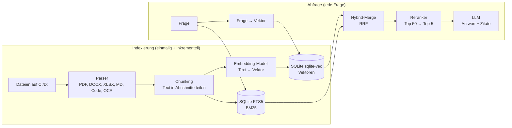

# Projektplan: Lokaler RAG für die eigenen Dateien

> Ziel: Eine Suchmaschine, die **komplett lokal** auf meinem PC läuft, den *Inhalt* meiner Dokumente versteht
> und Fragen in natürlicher Sprache beantwortet – mit Quellenangabe (Datei + Seite/Stelle).
>
> Beispiel: *„Wie lange ist die Kündigungsfrist in meinem Mietvertrag?“* → Antwort + Link auf `D:\Dokumente\Wohnung\Mietvertrag_2021.pdf`, Seite 4.

---

## 1. Was ist RAG überhaupt?

**RAG = Retrieval-Augmented Generation.** Ein Sprachmodell (LLM) kennt meine Dateien nicht. Statt es neu zu trainieren,
*sucht* man vor jeder Frage die passenden Textstellen heraus und gibt sie dem LLM als Kontext mit. Das LLM formuliert
daraus eine Antwort.



### Die Bausteine kurz erklärt

| Baustein | Was er macht | Warum er wichtig ist |
|---|---|---|
| **Parser** | Holt reinen Text aus PDF, Word, Excel, Mails, Bildern (OCR) | Schlechte Extraktion = schlechte Antworten. Hier steckt oft 50 % der Qualität. |
| **Chunking** | Zerlegt Dokumente in Stücke von ~300–800 Tokens mit Überlappung | Das LLM bekommt nur relevante Absätze statt ganzer 80-Seiten-PDFs. |
| **Embeddings** | Ein kleines Modell wandelt Text in einen Zahlenvektor (z. B. 1024 Dimensionen). Ähnliche *Bedeutung* → ähnliche Vektoren | Findet „Kündigungsfrist“ auch, wenn im Text „Beendigung des Mietverhältnisses“ steht. |
| **Vektor-Speicher** | Speichert Vektoren und findet die nächsten Nachbarn. Hier: `sqlite-vec` in derselben SQLite-Datei, keine separate Vektor-DB | Semantische Suche. Bei < ~1 Mio. Chunks reicht Brute-Force-Vergleich völlig aus. |
| **BM25 / Volltext** | Klassische Stichwortsuche | Exakte Begriffe (Rechnungsnummern, Namen, Fehlercodes) findet Vektorsuche schlecht. |
| **Hybrid + RRF** | Kombiniert beide Trefferlisten (Reciprocal Rank Fusion) | Best of both worlds – in Benchmarks fast immer besser als eine Methode allein. |
| **Reranker** | Ein Cross-Encoder bewertet *Frage + Chunk* gemeinsam, genauer aber langsamer | Sortiert die Top 50 neu und hebt die wirklich passenden nach oben. |
| **LLM** | Formuliert die Antwort aus den Chunks und zitiert die Quellen | Antwort statt Trefferliste. Zitate verhindern, dass man Halluzinationen blind glaubt. |

---

## 2. Ehrliche Einschätzung: Macht das Sinn?

### Schneller als die Windows-Suche?

**Kommt drauf an, was man sucht:**

| Suchfall | Windows-Suche | „Everything“ (voidtools) | Lokaler RAG |
|---|---|---|---|
| Dateiname bekannt (`steuer 2023.pdf`) | langsam, oft unzuverlässig | **sofort (< 50 ms)** | überdimensioniert |
| Exaktes Wort im Inhalt | mittel (nur wenn indiziert) | nur mit Zusatzfunktion | gut (BM25) |
| *Bedeutung* gesucht, Wortlaut unbekannt („der Vertrag mit der Klausel zur Preiserhöhung“) | ❌ | ❌ | **✅ Stärke von RAG** |
| Frage beantworten („Wie viel habe ich 2024 für Strom bezahlt?“) | ❌ | ❌ | **✅** |
| Gescannte PDFs / Fotos von Dokumenten | ❌ | ❌ | ✅ mit OCR |
| Deutsch fragen, englisches Dokument finden | ❌ | ❌ | ✅ (mehrsprachige Embeddings) |

**Fazit:** Für Dateinamen bleibt *Everything* unschlagbar. RAG ersetzt die Windows-Suche nicht, sondern **ergänzt**
sie dort, wo Stichwortsuche versagt. Gefühlt „schneller“ ist RAG, weil man nicht mehr 10 Dateien öffnen muss, um die
richtige Stelle zu finden.

**Latenz (geschätzt auf meiner Hardware):**
- Reine Suche (Retrieval + Rerank): **~100–300 ms**
- Mit LLM-Antwort: **~2–8 s** (Streaming, erste Wörter nach < 1 s)

### Braucht es zu viel Rechenleistung?

Meine Hardware (geprüft):

| Komponente | Vorhanden | Bewertung |
|---|---|---|
| GPU | **NVIDIA RTX 5060 Ti, 16 GB VRAM** | Sehr gut. Embeddings, Reranker *und* ein 8–14B-LLM passen gleichzeitig in den VRAM. |
| CPU | Ryzen 5 3600 (6 Kerne) | Ausreichend für Parsing/OCR, OCR wird der langsamste Teil. |
| RAM | 16 GB | Okay, aber knapp, wenn nebenbei viel läuft. Indexierung in Batches. |
| Speicher | C: 46 GB frei, **D: 445 GB frei** | Index und Modelle auf **D:** legen. |

**Grobe Schätzungen:**

- **Erstindexierung:** Embeddings auf der GPU schaffen einige hundert bis über tausend Chunks pro Sekunde.
  100.000 Dokumente ≈ 1 Mio. Chunks ≈ **30–90 Minuten** reines Embedding. Parsing und OCR kommen dazu
  (OCR: ~1–3 s pro Seite auf der CPU) – gescannte Dokumente also gezielt auswählen.
- **Danach:** Ein Datei-Watcher indexiert nur Änderungen → im Leerlauf praktisch **0 % Last**.
- **Index-Größe:** 1 Mio. Chunks × 1024 Dim × 4 Byte ≈ 4 GB (float32), mit int8-Quantisierung ≈ 1 GB.
- **LLM:** Ein 8B-Modell (Q4) braucht ~5–6 GB VRAM und läuft mit grob 50–100 Token/s. Wird nur bei Fragen geladen.

**Fazit:** Nein, für diesen PC kein Problem. Die GPU ist für dieses Projekt sogar ideal.

### Lohnt es sich fürs GitHub-Profil?

**Ja, und zwar besonders**, weil:
1. RAG ist *das* Standard-Pattern in KI-Anwendungen – Arbeitgeber fragen gezielt danach.
2. Ein **lokaler, datenschutzfreundlicher** RAG mit **messbarer Evaluation** hebt sich von den tausend
   „Chat with your PDF“-Tutorials ab.
3. Man zeigt viele Skills auf einmal: Datenpipelines, Information Retrieval, ML-Modelle, API-Design,
   Tests, Performance-Optimierung.

Was es **besonders** macht (statt nur LangChain-Tutorial nachgebaut):
- Hybrid-Suche + Reranking selbst gebaut und **mit Zahlen belegt**, dass es besser ist
- Inkrementelle Indexierung (nur geänderte Dateien)
- Benchmark gegen Windows-Suche
- MCP-Server, damit Claude/andere KI-Assistenten direkt die eigenen Dateien durchsuchen können

---

## 3. Anforderungen

### Funktional
- [ ] Ordner konfigurieren (Include/Exclude, z. B. `node_modules`, `.git`, `AppData` ausschließen)
- [ ] Dateitypen: `.pdf .docx .xlsx .pptx .txt .md .csv .html .eml/.msg`, Quellcode, optional Bilder (OCR)
- [ ] Inkrementelles Update (neue/geänderte/gelöschte Dateien erkennen)
- [ ] Suche: semantisch + Stichwort, Filter (Ordner, Dateityp, Datum)
- [ ] Fragen beantworten mit **Zitaten** (Datei, Seite, Textausschnitt), Klick öffnet die Datei
- [ ] CLI, Web-UI, später globaler Hotkey (z. B. `Alt+Leertaste`)

### Nicht-funktional
- **100 % lokal** – keine Daten verlassen den Rechner (Standard). Optional Cloud-LLM per Opt-in.
- Suche < 500 ms, Antwort-Start < 1,5 s
- Robust gegen kaputte/verschlüsselte Dateien (überspringen + loggen, nicht abstürzen)
- Sensible Ordner ausschließbar, keine Passwörter/Keys indexieren (Secret-Scanner-Filter)

---

## 4. Tech-Stack (Empfehlung)

| Bereich | Wahl | Alternativen | Begründung |
|---|---|---|---|
| Sprache / Env | **Python 3.12** mit **uv** | Poetry, pip | 3.14 ist installiert, aber PyTorch & Co. hinken neuen Python-Versionen oft hinterher. uv verwaltet die Version sauber. |
| PyTorch | **≥ 2.7 mit CUDA 12.8+** | – | Die RTX 50er-Serie (Blackwell) braucht neue CUDA-Builds. |
| Parsing | **PyMuPDF**, **python-docx**, **openpyxl**, **MarkItDown** | Docling, Unstructured | Schnell, leichtgewichtig. Docling für komplexe Layouts/Tabellen später als Upgrade. |
| OCR | **Windows.Media.Ocr** (eingebaut, de-DE + en-US) | Tesseract, RapidOCR, EasyOCR | Umgesetzt: keine Zusatzsoftware, kein Modell-Download. Nur für PDF-Seiten ohne Text, gedrehte Scans werden erkannt. Tesseract/RapidOCR später für Linux. |
| Chunking | Eigene Implementierung: strukturbewusst (Überschriften, Absätze), 500 Tokens, 15 % Überlappung | LangChain-Splitter | Selbst bauen = mehr lernen und im README erklärbar. |
| Embeddings | **BAAI/bge-m3** (mehrsprachig, 1024 Dim) | multilingual-e5-large, Qwen3-Embedding | Sehr gut für Deutsch + Englisch, läuft lokal auf der GPU. |
| Datenhaltung | **Eine SQLite-Datei** für Manifest, Chunks, Volltext und Vektoren | – | Ein System, eine Datei, Transaktionen: Datei geändert → Text und Vektoren atomar aktualisiert. Siehe [ADR 0001](docs/adr/0001-sqlite-statt-vektordatenbank.md). |
| Volltext | **SQLite FTS5** (BM25) + deutscher Snowball-Stemmer vorab in Python | Tantivy | FTS5 kann nur englisches Stemming. Deshalb Text vor dem Einfügen normalisieren. |
| Vektoren | **sqlite-vec** (int8/binär möglich) | NumPy/Torch Brute-Force, LanceDB, Qdrant | Keine separate Vektor-DB nötig. Hinter einem Interface gekapselt, damit ein Wechsel später möglich ist. |
| Reranker | **BAAI/bge-reranker-v2-m3** | mxbai-rerank | Mehrsprachig, deutliche Qualitätssteigerung. |
| LLM | **LM Studio** (lokaler Server, OpenAI-kompatible API) mit z. B. Qwen3.5 9B | llama.cpp, vLLM, Ollama, optional Claude API | Schon installiert. Der Client spricht die Standard-OpenAI-API und ist damit nicht an LM Studio gebunden. |
| Datei-Watcher | **watchdog** | Windows USN-Journal | Später USN-Journal für Profi-Bonus (so arbeitet auch Everything). |
| API | **FastAPI** | Flask | Async, Streaming, automatische Doku. |
| UI | Phase 1: **Typer**-CLI · Phase 2: Web-UI (FastAPI + HTMX oder React) · Phase 3: Tray-App mit Hotkey | Streamlit, Gradio | CLI zuerst = schnell testbar. |
| KI-Integration | **MCP-Server** (`search_files`, `read_passage`, `index_status`, Ordner-Freigabe per `--allow`) | – | Claude Desktop / Claude Code können dann die eigenen Dateien durchsuchen. Starkes Portfolio-Feature. |
| Qualität | **pytest**, **ruff**, **mypy**, GitHub Actions | – | Zeigt professionelle Arbeitsweise. |

> Bewusst **ohne** LangChain/LlamaIndex im Kern: Die Frameworks verstecken genau das, was man lernen und zeigen will.
> Optional später ein Vergleich „eigene Pipeline vs. LlamaIndex“ als Experiment.

---

## 5. Architektur

```
┌──────────────┐   Events    ┌──────────────┐   Jobs   ┌─────────────────────────────┐
│ File Watcher │ ──────────► │  Job-Queue   │ ───────► │ Ingest-Worker               │
│ (watchdog)   │             │ (SQLite)     │          │ parse → clean → chunk →     │
└──────────────┘             └──────────────┘          │ embed (GPU, Batches)        │
        ▲                                               └──────────┬──────────────────┘
        │ Scan beim Start (mtime + Hash vs. Manifest)               │
        │                                              ┌──────────▼──────────────────┐
        └───────────────────────────────────────────── │ localrag.db (SQLite, auf D:)│
                                                       │  documents  (Manifest)      │
                                                       │  chunks     (Text, Seite)   │
                                                       │  chunks_fts (FTS5 / BM25)   │
                                                       │  chunks_vec (sqlite-vec)    │
                                                       └──────────┬──────────────────┘
                                                                  │
                    ┌─────────────────────────────────────────────▼───────────┐
                    │ Query-Engine: Query-Embed → Hybrid (RRF) → Filter →      │
                    │ Rerank → Prompt bauen → LLM (LM Studio) → Antwort + Zitate  │
                    └───────┬─────────────────┬─────────────────┬──────────────┘
                            │                 │                 │
                         CLI (Typer)     FastAPI + Web-UI    MCP-Server
```

### Datenmodell (vereinfacht)

```sql
-- alles in einer Datei: D:\localrag\localrag.db
CREATE TABLE documents (id INTEGER PRIMARY KEY, path TEXT UNIQUE, hash TEXT, mtime REAL,
                        size INTEGER, filetype TEXT, status TEXT, error TEXT, indexed_at REAL);
CREATE TABLE chunks    (id INTEGER PRIMARY KEY, document_id INTEGER REFERENCES documents ON DELETE CASCADE,
                        text TEXT, page INTEGER, heading_path TEXT, char_start INTEGER, char_end INTEGER);
CREATE VIRTUAL TABLE chunks_fts USING fts5(body, tokenize='unicode61 remove_diacritics 2');  -- rowid = chunks.id, body = gestemmter Text
CREATE VIRTUAL TABLE chunks_vec USING vec0(embedding float[1024]);   -- rowid = chunks.id
```

Hybrid-Suche in einem Ablauf: FTS5 liefert Top 50 nach BM25, sqlite-vec liefert Top 50 nach Kosinus-Ähnlichkeit,
beide werden per RRF zusammengeführt und dann gerankt.

`heading_path` (z. B. *„Mietvertrag > §5 Kündigung“*) wird mit in den Chunk-Text fürs Embedding geschrieben
– ein einfacher Trick, der die Trefferqualität spürbar verbessert („contextual chunking“).

---

## 6. Repo-Struktur

```
RAG/
├── src/localrag/
│   ├── config.py           # Pydantic-Settings, Ordner, Modelle
│   ├── ingest/
│   │   ├── scanner.py      # Dateien finden, Manifest-Diff
│   │   ├── watcher.py      # watchdog
│   │   ├── parsers/        # pdf.py, office.py, text.py, ocr.py, email.py
│   │   └── chunker.py
│   ├── index/
│   │   ├── db.py           # SQLite-Verbindung, Schema, Migrationen
│   │   ├── embedder.py     # bge-m3, Batching, GPU
│   │   ├── vector_store.py # sqlite-vec (hinter Interface, austauschbar)
│   │   ├── fulltext.py     # SQLite FTS5
│   │   └── text_norm.py    # deutscher Stemmer, Kleinschreibung, Umlaute
│   ├── retrieval/
│   │   ├── hybrid.py       # RRF
│   │   └── reranker.py
│   ├── generation/
│   │   ├── llm.py          # OpenAI-kompatibler Client (LM Studio)
│   │   └── prompts.py
│   ├── api/                # FastAPI
│   ├── mcp_server.py
│   └── cli.py              # Typer: index, search, ask, status
├── eval/
│   ├── questions.jsonl     # Testfragen + erwartete Quelldatei
│   ├── run_eval.py         # Recall@k, MRR, Latenz
│   └── results/            # Ergebnisse als Markdown/Charts
├── tests/
├── docs/                   # Architektur, Entscheidungen (ADRs), Screenshots/GIFs
├── .github/workflows/ci.yml
├── pyproject.toml
└── README.md
```

---

## 7. Roadmap in Phasen

### Phase 0 – Setup (½ Tag)
- [x] `uv init`, Python 3.12, `pyproject.toml`, ruff, pytest, pre-commit
- [x] GitHub Actions CI (Lint + Tests + Eval + gitleaks)
- [x] LM Studio vorhanden, CUDA-Check (`torch.cuda.is_available()`) ✓ RTX 5060 Ti
- [ ] Testkorpus anlegen: ~200 eigene, *unkritische* Dateien in `D:\rag-testdata`

**Ergebnis:** Grünes CI-Badge, lauffähiges Grundgerüst.

### Phase 1 – MVP: Suchen über einen Ordner (1 Woche)

**1a – Stichwortsuche (BM25)**
- [x] Scanner + Parser für PDF, DOCX, TXT, MD
- [x] Einfacher Chunker (fixe Größe + Überlappung)
- [x] SQLite-Schema (`documents`, `chunks`, `chunks_fts`), deutscher Snowball-Stemmer vor dem Einfügen
- [x] `localrag index <ordner>` und `localrag search "<frage>"` → Top-10 mit Pfad + Ausschnitt
- [x] **Baseline festhalten:** 21 Testfragen auf synthetischem Korpus → [eval/results/latest.md](eval/results/latest.md)

**1b – Semantische Suche + Hybrid**
- [x] bge-m3-Embeddings → `chunks_vec` (sqlite-vec), fp16 auf der GPU, Modellwechsel wird erkannt (`--reembed`)
- [x] Hybrid-Suche mit RRF, Modi `keyword` / `semantic` / `hybrid`
- [x] Dieselben Fragen erneut → Vorher/Nachher-Vergleich in [eval/results/latest.md](eval/results/latest.md)
- [x] Bekannte Schwäche: CLI lädt das Modell bei jeder Suche neu (~20 s) → gelöst mit `localrag serve` (siehe Phase 5)

**Ergebnis:** Funktionierende Hybrid-Suche in einer SQLite-Datei. Erstes Demo-GIF fürs README.

### Phase 2 – Antworten generieren (3–4 Tage)
- [x] LM-Studio-Anbindung (OpenAI-kompatibel, Streaming, `<think>`-Filter), Prompt mit nummerierten Quellen `[1] [2]`
- [x] `localrag ask "<frage>"` mit Streaming-Ausgabe und Zitaten
- [ ] Antwortqualität messen (systematisch in Phase 3). Stichprobe mit 4 Fragen: Qwen3.5-9B 3/4, die Haustier-Ausnahme wird falsch auf die Katze angewendet, ein Prompt-Hinweis hilft nicht. Gemma 4 26B-A4B 4/4. Beide brauchen ~3 s, ~2,5 s davon bis zum ersten Token. Die früheren 8–56 s ließen sich im Eval-Korpus nicht reproduzieren, vermutlich Kaltstart
- [ ] „Ich weiß es nicht“-Verhalten, wenn nichts Relevantes gefunden wird

**Ergebnis:** Echter RAG – Frage rein, Antwort mit Quellen raus.

### Phase 3 – Qualität messen & verbessern (1 Woche) ⭐ *das Portfolio-Herzstück*
- [ ] **Eval-Set**: 50–100 Fragen mit bekannter Quelldatei (teils per LLM generiert, manuell geprüft)
  *(Zwischenstand: 16 Dokumente, 35 Fragen inkl. Fallen mit ähnlichen Dokumenten. Recall@1: BM25 0,60 · Vektor 0,89 · Hybrid 0,83. Gleich gewichtetes RRF kostet bei Umschreibungen Platz 1, daher als Nächstes Reranker bzw. gewichtetes RRF testen)*
- [ ] Metriken: **Recall@5, Recall@10, MRR**, Latenz p50/p95; für Antworten: Faithfulness (LLM-as-Judge)
- [ ] Experimente, jeweils mit Zahlen im README:
  1. nur Vektor vs. nur BM25 vs. **Hybrid (RRF)**
  2. ohne vs. **mit Reranker** ✅ *(echte Dateien: 24 Fragen Recall@1 0,79 → 0,88; 12 Fragen ohne gemeinsame Wörter Recall@5 0,42 → 0,67, Recall@1 aber 0,25 → 0,17; +0,33 s pro Suche → optional per `--rerank`)*
  3. Chunkgrößen 256 / 512 / 1024
  4. mit vs. ohne `heading_path`-Kontext
  5. Embedding-Modelle im Vergleich
- [x] **Benchmark gegen Windows-Suche** auf denselben Fragen (Wie oft ist die richtige Datei in den Top 5?)
  *(echte Dateien, 24 Fragen: Hybrid Recall@5 0,96 gegenüber Windows-Suche 0,25. Die Windows-Suche kennt D: nicht und scheitert an ganzen Sätzen. Aus dem Test umgesetzt: OCR für Scans, Duplikate zusammenfassen, DOCX-Notfallparser. Dazu ein zweites Set mit 12 Fragen ohne gemeinsame Wörter: dort Vektor 0,67 vor Hybrid 0,42. Offen: Kürzel-Dokumente, Mails aus fast nur Platzhaltern, gewichtetes RRF)*

**Ergebnis:** Eine Tabelle wie „Hybrid + Rerank: Recall@5 = 0,91 vs. Windows-Suche 0,34“ – genau so etwas
überzeugt beim Lesen eines GitHub-Profils.

### Phase 4 – Alltagstauglich (1–2 Wochen)
- [x] Inkrementelle Indexierung (Manifest mit Hash/mtime), gelöschte Dateien entfernen
- [ ] watchdog-Watcher als Hintergrunddienst
- [ ] Weitere Formate: XLSX, PPTX, HTML, E-Mails (.eml/.msg), Quellcode
- [x] OCR für gescannte PDFs *(Windows-OCR, Drehungserkennung, früher leere PDFs werden einmal nachgeholt)*
- [x] Nahezu gleiche Treffer (Backups, PDF + DOCX) zusammenfassen
- [ ] Exclude-Regeln, Secret-Filter, Fehler-Log für kaputte Dateien *(Fehler-Log: `localrag status --errors`; Neuversuch nach Parser-Update)*
- [ ] Filter in der Suche: `type:pdf`, `in:Rechnungen`, `after:2024-01`

### Phase 5 – Oberflächen & Integration (1–2 Wochen)
- [x] FastAPI-Dienst `localrag serve` mit `/search`, `/ask` (NDJSON-Streaming), `/health`; CLI nutzt ihn automatisch
- [ ] Web-UI: Suchfeld, Antwort, Quellen-Karten, Klick öffnet Datei an der Stelle
- [x] **MCP-Server** `localrag mcp` → in Claude Desktop/Code einbinden („Durchsuche meine Dateien nach …“) *(Code steht, Tests ausstehend)*
- [ ] Optional: Tray-App mit globalem Hotkey

### Phase 6 – Profi-Extras (optional, je nach Lust)
- [ ] Windows **USN-Journal** statt watchdog (extrem effizient, wie Everything)
- [ ] Bildersuche mit CLIP/SigLIP („Foto vom Strand mit Hund“)
- [ ] Query-Rewriting / HyDE, Multi-Query
- [ ] Vektor-Quantisierung (int8/binary) in sqlite-vec + Benchmark Speicher vs. Qualität
- [ ] Skalierungstest: ab wann wird Brute-Force zu langsam? Dann ANN-Index (z. B. LanceDB/Qdrant) hinter demselben Interface vergleichen
- [ ] Agentic RAG: LLM darf mehrfach suchen, z. B. „Summiere alle Stromrechnungen 2024“
- [ ] Docker-Compose für einfache Installation
- [ ] Blogpost / `docs/lessons-learned.md`

---

## 8. Risiken & Gegenmaßnahmen

| Risiko | Gegenmaßnahme |
|---|---|
| Private Daten landen versehentlich im Repo | `data/`, `index/`, `.env` in `.gitignore`. Eval nur mit synthetischen/öffentlichen Testdaten committen. |
| Halluzinationen | Antworten nur aus Kontext, Pflicht-Zitate, „keine Info gefunden“ erlauben, Faithfulness messen. |
| Indexierung dauert zu lange | Klein anfangen (ein Ordner), Batches, GPU, OCR nur opt-in, große Binärdateien überspringen. |
| C: läuft voll | Modelle (`OLLAMA_MODELS`, HF-Cache) und Index auf **D:** konfigurieren. |
| Schlechte PDF-Extraktion (Tabellen, Spalten) | Mit PyMuPDF starten, Problemfälle sammeln, gezielt Docling testen. |
| Python 3.14 nicht kompatibel mit ML-Libs | Projekt mit uv auf 3.12 pinnen. |
| sqlite-vec ist noch vor Version 1.0 / Brute-Force wird bei sehr vielen Chunks langsam | Vektorzugriff nur über `vector_store.py`, Quantisierung nutzen, Fallback NumPy/Torch auf der GPU. |
| FTS5 versteht kein Deutsch (Stemming, zusammengesetzte Wörter) | Eigene Normalisierung vor dem Einfügen. Den Rest fängt die Vektorsuche ab. |
| Scope Creep | Phasen strikt nacheinander. Nach Phase 3 ist das Projekt bereits vorzeigbar. |

---

## 9. GitHub aufpolieren – Checkliste

- [ ] **README** mit: Ein-Satz-Pitch, Demo-GIF ganz oben, Features, Architektur-Diagramm (Mermaid), Quickstart in 3 Befehlen, **Benchmark-Tabelle**, Roadmap
- [ ] Badges: CI, Python-Version, Lizenz
- [ ] Saubere Commits (Conventional Commits: `feat:`, `fix:`, `docs:`), Issues/Milestones pro Phase
- [ ] `docs/adr/` – kurze Entscheidungsdokumente („Warum SQLite statt Vektordatenbank?“) – zeigt Engineering-Denken
- [ ] Tests mit sinnvoller Abdeckung (Parser, Chunker, RRF sind gut testbar)
- [ ] Repo-Topics: `rag`, `llm`, `semantic-search`, `local-first`, `lm-studio`, `vector-database`, `mcp`
- [ ] Releases mit Changelog
- [ ] Profil-README verlinkt das Projekt als Highlight

---

## 10. Glossar

- **Token** – Wortstück, die Einheit, in der LLMs zählen (~0,75 Wörter auf Englisch, etwas weniger auf Deutsch).
- **Embedding** – Vektor, der die Bedeutung eines Textes repräsentiert.
- **Kosinus-Ähnlichkeit** – Maß, wie ähnlich zwei Vektoren in ihrer Richtung sind.
- **ANN / HNSW / IVF** – Verfahren, um *ungefähr* nächste Nachbarn schnell zu finden, ohne alle Vektoren zu vergleichen.
- **BM25** – Klassischer Ranking-Algorithmus der Stichwortsuche (gewichtet seltene Wörter höher).
- **RRF** – Reciprocal Rank Fusion: `score = Σ 1 / (k + rank)`, kombiniert Ranglisten ohne Score-Normalisierung.
- **Bi-Encoder vs. Cross-Encoder** – Bi-Encoder: Frage und Text getrennt einbetten (schnell, für Suche). Cross-Encoder: beide zusammen bewerten (genau, für Reranking).
- **Context Window** – Wie viel Text ein LLM auf einmal verarbeiten kann.
- **Quantisierung (Q4, int8)** – Gewichte/Vektoren mit weniger Bits speichern → weniger Speicher, minimal schlechter.
- **Recall@k** – Anteil der Fragen, bei denen die richtige Quelle unter den Top k Treffern ist.
- **MRR** – Mean Reciprocal Rank: Wie weit oben steht der richtige Treffer im Schnitt.
- **Faithfulness** – Stützt sich die Antwort wirklich auf die Quellen (statt erfunden)?
- **MCP** – Model Context Protocol: offener Standard, über den KI-Assistenten externe Tools nutzen können.

---

## 11. Nächster konkreter Schritt

1. Phase 0 umsetzen (Projektgerüst, CI, LM Studio + CUDA-Check)
2. Testordner mit ~200 Dateien auf `D:` anlegen
3. Phase 1a starten: erster `localrag search`-Aufruf mit BM25
