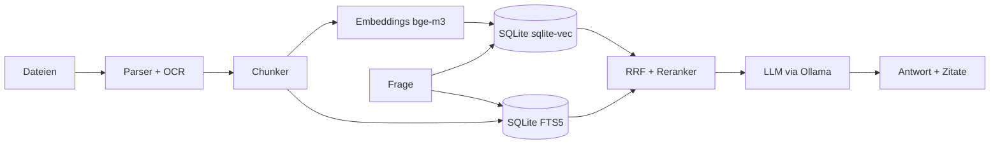

# LocalRAG – Semantische Suche über die eigenen Dateien

> Frag deinen Computer in natürlicher Sprache – komplett lokal, mit Quellenangabe.

**Status:** 🚧 In Planung – siehe [PLAN.md](PLAN.md)

## Idee

Die Windows-Suche findet Dateinamen und exakte Wörter. LocalRAG versteht den **Inhalt**:

```text
> localrag ask "Wie lange ist die Kündigungsfrist in meinem Mietvertrag?"

Die Kündigungsfrist beträgt drei Monate zum Monatsende [1].

[1] D:\Dokumente\Wohnung\Mietvertrag_2021.pdf – Seite 4, §5 Kündigung
```

## Geplante Features

- 🔒 **100 % lokal** – keine Daten verlassen den Rechner (Ollama + lokale Embeddings)
- 🔎 **Hybrid-Suche** – semantische Vektorsuche + BM25-Stichwortsuche + Reranking
- 📄 PDF, Word, Excel, PowerPoint, Markdown, E-Mails, Quellcode, OCR für Scans
- ⚡ **Inkrementelle Indexierung** – nur geänderte Dateien werden neu verarbeitet
- 📊 **Messbare Qualität** – Eval-Set mit Recall@k / MRR, Benchmark gegen die Windows-Suche
- 🤖 **MCP-Server** – Claude & Co. können direkt in den eigenen Dateien suchen

## Architektur



## Tech-Stack

Python 3.12 · uv · PyTorch/CUDA · sentence-transformers · SQLite (FTS5 + sqlite-vec) · Ollama · FastAPI · Typer · MCP

## Lizenz

Siehe [LICENSE](LICENSE).
