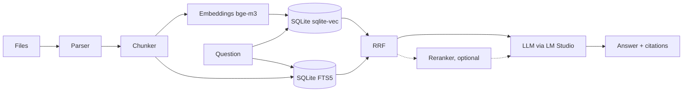

# LocalRAG – Semantic search over your own files

[](https://github.com/Dualshok3/localRAG/actions/workflows/ci.yml)

[](LICENSE)
[](https://github.com/Dualshok3/localRAG/releases)


> Ask your computer in plain language – fully local, with sources.


*Web UI (`localrag serve`, then http://127.0.0.1:8765) over the made-up test corpus: search, an answer with
citations from Gemma 4 26B, filters by folder and date. The timings are real.*

Windows Search finds file names and exact words. LocalRAG understands the **content**: the question
"Darf ich eine Katze halten?" ("Am I allowed to keep a cat?") finds the *pets* clause in the rental
contract, even though the word "cat" appears nowhere in it.

```text
> localrag ask "Darf ich eine Katze halten?"

Die Haltung von Haustieren bedarf der vorherigen Zustimmung des Vermieters, ausgenommen es handelt
sich um Kleintiere in Käfigen [1].

Quellen
[1] D:\Dokumente\Wohnung\mietvertrag.md  · Mietvertrag Wohnung Lindenstraße 12 > §8 Haustiere
```

*Answer from Gemma 4 26B over the synthetic test corpus ("Keeping pets requires the landlord's prior
consent, except for small animals in cages"), path shortened. Search about 30 ms, answer about 3 s.*

LocalRAG is built for German-speaking users: the CLI, the web UI and the answer prompt are in German, and
the test corpus and stemming are German. The search itself is multilingual (bge-m3), so English documents
work as well.

## Features

- 🔒 **100% local:** embeddings on your own GPU (or CPU), answers via LM Studio or any other local
  OpenAI-compatible server. No cloud, no account.
- 🔎 **Hybrid search:** BM25 keyword search (SQLite FTS5, German stemming) plus vector search
  (bge-m3, sqlite-vec), merged with Reciprocal Rank Fusion. Everything lives in **one** SQLite file,
  reasoning in [ADR 0001](docs/adr/0001-sqlite-statt-vektordatenbank.md).
- 💬 **Answers with citations:** every statement is backed by `[n]`. If the files don't contain the
  answer, the model says so instead of guessing.
- ⚡ **Incremental:** on the second run only changed files are processed again.
- 🎯 **Optional reranker:** `--rerank` re-sorts the candidates with a cross-encoder. It helps with
  paraphrased questions but costs about 0.3 s per search
  ([measurements](#harder-questions-weighting-and-reranker)).
- 🧭 **Filters in the query:** `type:pdf`, `in:Rechnungen`, `-in:Backup`, `after:2024-01`,
  `before:2024-07` – in the CLI, web UI, API and MCP.
- 🚀 **Background service with web UI:** `localrag serve` keeps the model loaded, so searches take
  milliseconds. Results open with one click, PDFs right at the matching page.
- 👀 **Always up to date:** `localrag watch` or `serve --watch` watches the folders and indexes new,
  changed and deleted files within seconds.
- 🤖 **MCP server:** Claude Desktop, Claude Code and other clients can search your files directly.
- 📊 **Measured, not claimed:** an eval set compares keyword, vector and hybrid search; the results are
  [further down](#measurements-keyword-vs-vector-vs-hybrid).

Formats: PDF (scanned PDFs via OCR, no extra software needed on Windows), DOCX, XLSX, PPTX, HTML,
e-mails (EML, MSG), Markdown, TXT, CSV. Source code on request (`code = true` in the config).
Skipped instead of indexed: dictionaries and data lists, CSV exports with more than 5,000 rows, HTML
documentation generated by tools (Sphinx, Doxygen, Javadoc …) and program files that happen to end in
`.msg`.

## Quickstart

Requirement: [uv](https://docs.astral.sh/uv/).

```bash
git clone https://github.com/Dualshok3/localRAG.git && cd localRAG
uv sync --extra semantic --extra ocr          # PyTorch/CUDA + Windows OCR; without extras: keyword search only
uv run localrag index "D:\Dokumente"          # incremental, the second run only processes changes
uv run localrag search "Darf ich eine Katze halten?"
uv run localrag search "PF-1234" --mode keyword   # fast, no model
uv run localrag status --errors
```

| Variable | Meaning | Default |
|---|---|---|
| `LOCALRAG_DB` | Index database (also `--db`) | `db` from the config, otherwise `~/.localrag/localrag.db` |
| `LOCALRAG_CONFIG` | Config file | `~/.localrag/config.toml` |
| `LOCALRAG_MODELS` | Where models are stored (~4.5 GB) | Hugging Face cache |
| `LOCALRAG_EMBEDDING_MODEL` | Embedding model | `BAAI/bge-m3` |
| `LOCALRAG_DEVICE` | Device for the embedding and reranker model | `device` from the config, otherwise automatic |
| `LOCALRAG_LLM_URL` | OpenAI-compatible chat server | `http://localhost:1234/v1` (LM Studio) |
| `LOCALRAG_LLM_MODEL` | Model ID on the server | the model already loaded |

### Configuration: which folders, what to leave out

Instead of passing the folders on every call, they live in `~/.localrag/config.toml`
(create a template with `localrag config --init`, show it with `localrag config`):

```toml
folders = ["D:/Dokumente", "C:/Users/me/Desktop"]
exclude = ["python_projects", "*backup*", "D:/Dokumente/Alt"]
max_file_mb = 50
db = "D:/localrag/index.db"
code = false        # also index source code (.py, .js, .cs …)
```

`exclude`: a name or pattern applies to folders and files anywhere, a path applies only to exactly that
folder. The built-in exclusions (`node_modules`, `.git`, `AppData`, `Windows`, …) apply on top. If an
exclusion is added later, the affected files disappear from the index on the next run. `localrag index`
without folders then uses `folders`.

Why this matters is shown by the [whole-drive test](#whole-drives): copies of personal details in code
projects pushed the originals out of the results. `exclude = ["python_projects"]` fixes that at the root,
`-in:python_projects` in the query fixes it case by case.

### Filters in the query

```bash
uv run localrag search "Stromrechnung type:pdf after:2024"
uv run localrag search "Kündigung in:Wohnung -in:Backup"
uv run localrag ask "Wie hoch war der Abschlag? in:Stadtwerke before:2024-07"
```

| Filter | Effect |
|---|---|
| `type:pdf`, `type:pdf,docx` | only these file types |
| `in:Rechnungen`, `in:"Meine Dokumente"` | path contains this part (case-insensitive) |
| `-in:Backup` | path does not contain it |
| `after:2024`, `after:2024-03`, `after:2024-03-15` | file modified on or after this date |
| `before:2024-07` | file modified before this date |

With filters, the vector search computes exactly within the matching subset instead of searching globally
and filtering afterwards. Otherwise `in:Rechnungen` would often leave nothing, because the best hits of
the whole index are somewhere else.

### Keeping the index up to date

```bash
uv run localrag watch                # watch the folders from the config (separate process)
uv run localrag serve --watch        # or inside the service: one process, one loaded model
```

On start it catches up once on everything that changed in the meantime. After that the watcher collects
file events and processes them together after 2 s of quiet. A program that writes several times while
saving therefore triggers only one re-index. Deleted and renamed files and folders disappear from the
index. To have this run without any manual step, `localrag autostart --enable` starts the service with the
watcher invisibly at every Windows sign-in (script in the Startup folder, no admin rights needed, log at
`~/.localrag/serve.log`). `--disable` undoes it.

```bash
uv run localrag autostart --enable
```

### Adding files right away

Anything that lands in a watched folder is searchable after about 2 s. For everything else, such as files
on a USB stick or documents just opened in the browser, there are three ways:

| Way | How |
|---|---|
| Explorer | Right-click → *Send to* → *LocalRAG (indexieren)*, set up once with `localrag sendto --enable`. A short dialog reports the result. |
| Web UI | Drag files onto the page or choose *＋ Dateien*. They are copied to the inbox folder (`inbox` in the config, default `Documents\LocalRAG-Eingang`) and indexed immediately. |
| Command line | `localrag add <file-or-folder>` |

If the service is running, all three use its already loaded model, so no second copy ends up in GPU
memory. Files outside the watched folders are added once; later changes to them are not picked up
automatically.

### Web UI

`localrag serve` provides a UI at http://127.0.0.1:8765 with no external dependencies: search with
`Enter`, ask with `Ctrl`+`Enter`, citations `[n]` jump to the source. "Öffnen" (open) launches the default
program, "Im Ordner zeigen" (show in folder) opens Explorer, and PDFs can open in the browser at the
matching page. The page follows the system's light or dark theme and also works in narrow windows.

Protection against other websites in the same browser: the service rejects requests with a foreign host
header (DNS rebinding), and opening files requires a custom header that a foreign page cannot send without
a CORS grant. Only files that are in the index are served.

### Answering questions (local LLM)

`localrag ask` finds the matching passages and lets a local language model write an answer with sources.
Tested with [LM Studio](https://lmstudio.ai). Any OpenAI-compatible server works too (llama.cpp, vLLM,
Ollama).

```bash
lms server start                     # LM Studio server
lms load gemma-4-26b-a4b-it          # or another model
uv run localrag ask "Wie hoch ist der neue Stromabschlag?"
```

Spot check with 4 questions on an RTX 5060 Ti (16 GB): both models answer in about 3 s.

| Model | correct | Notable |
|---|---|---|
| Qwen3.5-9B | 3/4 | "Am I allowed to keep a cat?" → "Yes", because it classifies the cat as a "small animal in a cage" |
| **Gemma 4 26B-A4B** (MoE) | **4/4** | correctly names the condition: the landlord's consent |

In both cases the search returned the right clause, so the mistake lies in the smaller model's reasoning,
not in retrieval.

The model only gets the passages that were found and must back every statement with `[n]`. If the answer
is not in the sources, it says "Dazu habe ich in deinen Dateien nichts gefunden." ("I found nothing about
this in your files.")

bge-m3 is downloaded on first start. Without the service, the CLI loads the model again for every search,
which takes about 20 s. The background service is faster:

```bash
uv run localrag serve            # keeps the model loaded, reachable on 127.0.0.1 only
uv run localrag search "…"       # uses the service automatically → answer in milliseconds
uv run localrag search "…" --local   # ignore the service
```

The service also offers an HTTP API (`/search`, `/ask`, `/health`, `/stats`, `/file`, `/open`, `/index`,
`/upload`, docs at `http://127.0.0.1:8765/docs`). Because it hands out the contents of your files, it binds
to 127.0.0.1 only by default.

### As a tool for Claude (MCP)

With `localrag mcp`, Claude Desktop, Claude Code and other MCP clients get three tools: `search_files`,
`read_passage` (full text of a hit including neighbouring passages) and `index_status`. The assistant can
search several times and read up on specific passages.

```bash
uv sync --extra semantic --extra mcp
claude mcp add localrag -- uv --directory C:\path\to\localRAG run localrag mcp --allow "D:\Dokumente"
```

For Claude Desktop, in `claude_desktop_config.json`:

```json
{
  "mcpServers": {
    "localrag": {
      "command": "uv",
      "args": ["--directory", "C:\\path\\to\\localRAG", "run", "localrag", "mcp", "--allow", "D:\\Dokumente"],
      "env": { "LOCALRAG_DB": "D:\\localrag\\localrag.db", "LOCALRAG_MODELS": "D:\\localrag\\models" }
    }
  }
}
```

> **Privacy:** whatever the tools return ends up in the assistant's context. With a cloud model these
> excerpts leave your computer, unlike `localrag ask` with LM Studio. `--allow` limits what is handed out
> to specific folders; hits from other folders are then withheld completely.

## Measurements: keyword vs. vector vs. hybrid

Synthetic test corpus with 16 documents and 40 questions ([eval/results/latest.md](eval/results/latest.md)).
It deliberately contains similar documents as traps: electricity bills for 2023 and 2024, a flat and a
garage rental contract, an old and a current employment contract.

| Questions | n | BM25 | Vector (bge-m3) | Hybrid (RRF) |
|---|---|---|---|---|
| Keywords from the document | 12 | 1.00 | 1.00 | 1.00 |
| Paraphrases ("Am I allowed to keep a cat?" → *pets*) | 13 | 0.23 | **0.92** | 0.69 |
| Exact identifiers (serial number, IP, amount) | 5 | **1.00** | 0.40 | **1.00** |
| Telling similar documents apart ("electricity **2023**") | 10 | 0.50 | **0.90** | 0.70 |
| **Total** | 40 | 0.62 | **0.88** | 0.82 |

Shown is Recall@1, i.e. how often the right file is in first place. At Recall@3, vector and hybrid both
reach 1.00, so the right file is always among the top three. Latency per search on the GPU: about 25 ms.

What this shows:
- **BM25** fails on paraphrases, **vectors** fail on exact identifiers.
- **Hybrid** is perfect on identifiers but loses places on paraphrases. Plain RRF weights both lists
  equally. When BM25 only finds chance word matches in wrong files, they push the right vector hit to
  second or third place.
- Hybrid is the default because it is never completely off. For full sentences the BM25 list is weighted
  lower, and there is an optional reranker. Both help on real files, hardly at all on this synthetic
  corpus, see [Harder questions, weighting and reranker](#harder-questions-weighting-and-reranker).

Limitation: 40 questions are few; one or two questions shift the values by several percentage points.
Measure it yourself: `uv run python eval/run_eval.py`

## Answer quality

Search provides the sources, a language model turns them into the answer. Whether that answer is right is
measured by [eval/run_answer_eval.py](eval/run_answer_eval.py) on the same made-up corpus: 20 answerable
questions with a reference answer (core statement plus optional details) and 5 traps whose answer is not in
the files, such as the no-claims class of the *partial* car insurance when only liability and fully
comprehensive cover are mentioned. All models get the same sources. A judge model checks whether the core
statement is met and every statement is backed by a source (LLM-as-judge, temperature 0). Whether the model
says "I don't know" and cites the right file is counted without a judge.

| Model | correct | backed | citation to right file | "I don't know" correct | response time p50 |
|---|---|---|---|---|---|
| **Gemma 4 26B-A4B** (LM Studio) | **20/20** | **20/20** | **20/20** | **5/5** | 2.8 s |
| crit engine (Gemma 4) | 18/20 | **20/20** | 19/20 | **5/5** | 6.8 s |
| Qwen3.5-9B (LM Studio) | 17/20 | 19/20 | **20/20** | 4/5 | 2.9 s |

Judge model: crit engine. Full list of mistakes: [eval/results/answers.md](eval/results/answers.md).

- **Qwen** reasons wrongly: a cat is supposedly a "small animal in a cage" and needs no consent, a 24-month
  warranty from March 2024 supposedly ends in September 2025, and asked about an additional payment it says
  "yes" while naming the credit in the same sentence. For the partial car insurance it invents a no-claims
  class.
- **The crit engine** once gives the instalment from the *older* bill (65 instead of 70 EUR) and once leaves
  out the purchase date. It invents nothing, and on every trap it says "I don't know".
- **Gemma** makes no mistakes.

Limitations: 25 questions are few. The judge is also one of the models under test and might rate its own
answers more leniently. With Gemma as the judge and stricter references the ranking was the same (Gemma
ahead of Qwen). The crit engine's response time was measured under parallel load.

```bash
uv run python eval/run_answer_eval.py --models gemma-4-26b-a4b-it,qwen3.5-9b --judge gemma-4-26b-a4b-it --write-report
```

`localrag ask` works with any OpenAI-compatible server. Which one is set in the config:

```toml
llm_url = "http://127.0.0.1:8000/v1"
llm_model = "my-model"
```

If the language model runs on the same GPU and memory gets tight, the embedding model can move to the CPU:
put `device = "cpu"` in the config or set the environment variable `LOCALRAG_DEVICE`. Measured on an index
with 7,193 passages: a search then takes 0.3 to 0.5 s. The first search after start loads the model and
takes just under a minute once. Re-indexing whole folders becomes considerably slower.

## Test with real files

Also tested on a real computer: Desktop, Documents, Downloads and a university folder with 334 files.
Among them are contracts, course material, a thesis, five textbooks with several hundred pages each and the
usual clutter such as game configs. The questions and data stay private; only the numbers are shown here.
Hardware: RTX 5060 Ti 16 GB.

| Step | Time |
|---|---|
| Extract text + keyword index (334 files → 6,788 passages) | 33 s |
| Compute vectors (bge-m3, GPU) | 102 s (~67 passages/s) |
| Second run, nothing changed | 0.2 s |
| Index size | 66 MB |

| Search | p50 | p95 |
|---|---|---|
| Keyword (in process) | 4.6 ms | 10 ms |
| Hybrid (in process, incl. embedding the question) | 51 ms | 64 ms |
| Keyword via the service (HTTP) | 10 ms | 46 ms |
| Hybrid via the service (HTTP) | 56 ms | 70 ms |
| `localrag search` via the service (incl. Python start-up) | ~2 s | |
| `localrag search` without the service (model is loaded) | ~19 s | |
| `localrag ask` with Gemma 4 26B via the service | 6–8 s | |

**Hit rate** on 24 questions with a known right file, two of them about scanned PDFs:

| | BM25 | Vector | Hybrid | Windows Search |
|---|---|---|---|---|
| Recall@1 | 0.79 | 0.75 | **0.79** | 0.25 |
| Recall@5 | 0.83 | 0.92 | **1.00** | 0.25 |

By default Windows Search only indexes the user folders on C:; the university folder on D: is missing
entirely. Counting only questions about files it knows, it finds 6 of 13. Full sentences almost always
return zero hits there; only keywords and identifiers work.

The test with real files showed typical stumbling blocks. This is how LocalRAG handles them:

| Finding | Solution | Effect |
|---|---|---|
| 8 scanned PDFs without a text layer, e.g. a school report | OCR via the built-in Windows text recognition; rotated scans are detected automatically | all 8 readable, "Which grade is on my report?" is answered correctly |
| Many near-identical backups of the same file take all top places | Near-identical passages (≥ 85% identical words) are merged into one hit, with a note "+ same content in …" | room for other files |
| DOCX with a damaged embedded image is unreadable | Fall back to reading the text directly from `word/document.xml` | file readable |
| Empty LLM answer for an unanswerable question | Fixed sentence "Dazu habe ich in deinen Dateien nichts gefunden." | |
| No model loaded → LM Studio loaded a different one (10 GB) without asking | Clear error message instead of a silent switch | |

Without these measures hybrid Recall@5 would be 0.88 instead of 0.96 on the same 24 questions. With the
weighting (next section) it is 1.00.

### Harder questions, weighting and reranker

The 24 questions above were written after reading the documents and therefore often share words with them,
which favours BM25. Two more sets complement them: 12 questions that deliberately use different words
(question and document share no word; two of them ask in German about English documents) and 42 mixed
questions about further documents (school reports, a boarding pass, e-mails, study notes). 78 in total.

| Variant | 24 base | 12 hard | 42 mixed | **all 78** | p50 |
|---|---|---|---|---|---|
| BM25 | 0.79 / 0.83 | 0.17 / 0.33 | 0.62 / 0.79 | 0.60 / 0.73 | 20 ms |
| Vector | 0.75 / 0.92 | 0.42 / 0.67 | 0.74 / 0.93 | 0.69 / 0.88 | 54 ms |
| Hybrid, both lists equal | 0.79 / 0.96 | 0.25 / 0.42 | 0.71 / 0.90 | 0.67 / 0.85 | 54 ms |
| **Hybrid, weighted (default)** | 0.79 / **1.00** | 0.33 / **0.67** | 0.76 / 0.95 | **0.71 / 0.92** | 53 ms |
| Hybrid weighted + reranker (`--rerank`) | **0.88 / 1.00** | 0.25 / 0.58 | **0.83 / 0.98** | **0.76 / 0.92** | 388 ms |

Values: Recall@1 / Recall@5. MRR over all 78: vector 0.76, hybrid unweighted 0.75, weighted 0.79, with
reranker 0.83.

**Weighting by query type.** For full sentences BM25 finds many chance hits through common words and pushes
the right vector hit down. That's why the BM25 list counts only 0.3× for sentences, detected by filler words
such as "ich", "der", "wann" or a question mark. For identifiers and keywords ("WTEST-998877", "Router
Firmware") it counts fully. This costs no time and beats both individual methods. Fixed weights of 0.5 and
0.3 for all queries were tested too: they lose identifiers such as booking and order numbers that only BM25
finds.

**Reranker.** [bge-reranker-v2-m3](https://huggingface.co/BAAI/bge-reranker-v2-m3) reads the 40 best
passages together with the question and re-sorts them. It mostly improves first place (0.71 → 0.76) but
costs a good 0.3 s per search, so it stays optional. Blending its order with the first stage's instead of
replacing it was tested as well: on these 78 questions it was on par (MRR 0.84 instead of 0.83), but worse
over whole drives (Recall@1 0.69 instead of 0.73). That's why the reranker replaces the order.

What no variant finds: two short e-mails whose text consists almost entirely of placeholders and whose topic
hides in an abbreviation ("SF-Klasse" for the no-claims discount), and the bill that consists almost
entirely of upper-case abbreviations.

Limitation: on the synthetic corpus above the weighting changes nothing (hybrid Recall@1 stays at 0.83).
There, BM25 often has wrong files in first place that are also in second place for vectors. In RRF that is
still enough for first place even with a weight of 0.3.

### Whole drives

The hardest test: all of C: and D:, without system and program folders. That includes code projects,
games, model downloads and tool folders, i.e. lots of content competing with the documents you are looking
for.

| | user folders | whole drives | with config² |
|---|---|---|---|
| Files scanned | 334 | 8,771 | 381 |
| indexed / skipped / errors | 313 / – / 21¹ | 8,372 / 375 / 13 | 369 / 7 / 5 |
| Passages | 6,808 | 57,498 | 7,193 |
| First run incl. vectors | 2.3 min | 30 min | 2.7 min |
| Second run, nothing changed | 0.2 s | 1:49 min (scanning 2 drives) | 4.4 s |
| Hybrid search via the service, p50 | 56 ms | 53 ms | – |
| Hybrid Recall@1 / @5 (78 questions) | 0.71 / 0.92 | 0.67 / 0.83 | 0.68 / 0.90 |
| with reranker | 0.76 / 0.92 | 0.73 / 0.86 | **0.74 / 0.94** |

¹ Measured without the UTF-16 detection from the table below; most of these errors were UTF-16 files.
² User folders plus all of D:, with a [config](#configuration-which-folders-what-to-leave-out): code
projects, games and tool folders excluded via `exclude`, with all formats (including Excel, PowerPoint,
HTML, e-mails). More folders than "user folders", but hardly more noise: with the reranker this is the best
value of all three indexes.

What makes whole drives hard, and how LocalRAG handles it:

| Finding | Solution |
|---|---|
| The scanner followed Windows junctions such as "Dokumente und Einstellungen" → `C:\Users` | Junctions and symlinks are skipped |
| 79 "binary files" were UTF-16 text, as many Windows programs write it | UTF-16 with and without BOM is detected |
| Dictionaries, tokenizer vocabularies and translation tables (over 16,000 passages together) pushed out real hits | A .txt with hundreds of lines of 1–3 words and hardly any sentences, or with a line over 50,000 characters, counts as a word/data list and is skipped |
| Vector search took 309 instead of 54 ms because sqlite-vec compares every vector one by one | The service and MCP server keep the vectors as a matrix in RAM (230 MB). A version number in the database triggers a reload after changes |
| Loading that matrix took 48 s because sqlite-vec returns vector by vector | Read the blocks in which sqlite-vec stores 1,024 vectors each directly: 1.7 s, checked against the slow path, with automatic fallback |
| Thousands of MuPDF messages about broken PDFs in the log | Messages turned off; real errors still come through as errors |

The remaining gap in hit rate comes mostly from real copies. The same career details also appear in dozens
of text drafts in the code projects. For a question about a date, these related texts rank above the
original document, which is the only one that contains the date. That's not a fault of the index, but it
shows that the choice of folders to index affects quality more than any fine-tuning. That's why there is
the [config file](#configuration-which-folders-what-to-leave-out) with exclusions and the detection of
generated HTML documentation: of 1,848 HTML files on C: and D:, only 7 were in the user folders. The rest
came from code projects, the Python docs (Sphinx) and games.

**Deliberately not included: a year bonus.** Idea: for "Stromrechnung 2023", prefer passages that carry 2023
in the path or text. Result on 40 synthetic questions (9 of them with a year) and the 78 real ones: not a
single change. bge-m3 already handles years itself, partly because the file name is embedded too. The only
miss ("instalment from March 2024" is in the *2023* bill) cannot be solved that way.

## Architecture



| Step | Implementation | Code |
|---|---|---|
| Parsing | PyMuPDF (PDF, per page), python-docx (headings, tables), openpyxl (per sheet), python-pptx (per slide, with notes), HTML, e-mails (EML/MSG with attachments), Markdown/TXT/CSV | [ingest/parsers](src/localrag/ingest/parsers) |
| Updating | watchdog events, collected for 2 s, then incremental like `localrag index` | [watcher.py](src/localrag/ingest/watcher.py) |
| Chunking | Pack paragraphs into ~350 words, 50 words of overlap, remember the heading path | [chunker.py](src/localrag/ingest/chunker.py) |
| Keyword index | FTS5 with BM25, text reduced to word stems with Snowball beforehand | [text_norm.py](src/localrag/index/text_norm.py) |
| Vector index | bge-m3 (1024 dims, fp16 on CUDA), normalized in sqlite-vec | [vector_store.py](src/localrag/index/vector_store.py) |
| Filters | `type:` `in:` `-in:` `after:` `before:` from the query, vector search exactly within the subset | [filters.py](src/localrag/retrieval/filters.py) |
| Fusion | Reciprocal Rank Fusion (k = 60), BM25 list weighted 0.3× for full sentences | [hybrid.py](src/localrag/retrieval/hybrid.py) |
| Reranking (optional) | bge-reranker-v2-m3 reads question + passage together and re-sorts the top 40 | [reranker.py](src/localrag/retrieval/reranker.py) |
| Answer | Prompt with sources only, citations required, protection against instructions inside documents | [prompts.py](src/localrag/generation/prompts.py) |

## No private data in the repo

The project works with very personal files, so there are several safeguards:

- Index, models and documents live outside the repo (`~/.localrag`, `LOCALRAG_MODELS`).
- The test corpus is entirely made up ([eval/corpus](eval/corpus)). Test PDFs and DOCX files are only
  generated at runtime.
- [pre-commit](.pre-commit-config.yaml) blocks documents, databases and `.env` files
  ([check_private_files.py](scripts/check_private_files.py)) and scans for secrets with gitleaks.
  gitleaks also runs in CI.

## Tech stack

Python 3.12 · uv · PyTorch/CUDA · sentence-transformers · SQLite (FTS5 + sqlite-vec) · LM Studio (OpenAI API) · httpx · FastAPI · Typer · watchdog · MCP

## Development

```bash
uv sync                          # without PyTorch, tests use a fake embedding
uv run pytest -q
uv run ruff check . && uv run ruff format --check .
uvx pre-commit install           # guards against private files and secrets on every commit
```

CI runs on Windows and Ubuntu and additionally checks that keyword search keeps a minimum quality in the
eval. Changes per version are listed in the [CHANGELOG](CHANGELOG.md).

## License

See [LICENSE](LICENSE).
