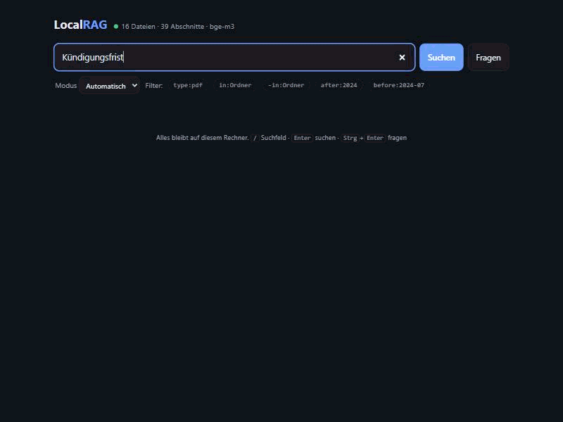
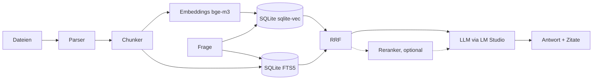

# LocalRAG – Semantische Suche über die eigenen Dateien

[](https://github.com/Dualshok3/RAG/actions/workflows/ci.yml)

[](LICENSE)
[](https://github.com/Dualshok3/RAG/releases)


> Frag deinen Computer in natürlicher Sprache – komplett lokal, mit Quellenangabe.



*Web-Oberfläche (`localrag serve`, dann http://127.0.0.1:8765) über den erfundenen Testkorpus: Suche,
Antwort mit Zitaten von Gemma 4 26B, Filter nach Ordner und Datum. Die Zeiten sind echt.*

Die Windows-Suche findet Dateinamen und exakte Wörter. LocalRAG versteht den **Inhalt**: Die Frage
„Darf ich eine Katze halten?“ findet den Paragrafen *Haustiere* im Mietvertrag, obwohl das Wort „Katze“
dort nirgends steht.

```text
> localrag ask "Darf ich eine Katze halten?"

Die Haltung von Haustieren bedarf der vorherigen Zustimmung des Vermieters, ausgenommen es handelt
sich um Kleintiere in Käfigen [1].

Quellen
[1] D:\Dokumente\Wohnung\mietvertrag.md  · Mietvertrag Wohnung Lindenstraße 12 > §8 Haustiere
```

*Antwort von Gemma 4 26B über den synthetischen Testkorpus, Pfad gekürzt. Suche rund 30 ms, Antwort rund 3 s.*

## Was es kann

- 🔒 **100 % lokal:** Embeddings auf der eigenen GPU, Antworten über LM Studio oder einen anderen lokalen
  OpenAI-kompatiblen Server. Keine Cloud, kein Konto.
- 🔎 **Hybrid-Suche:** BM25-Stichwortsuche (SQLite FTS5, deutsches Stemming) plus Vektorsuche
  (bge-m3, sqlite-vec), zusammengeführt per Reciprocal Rank Fusion. Alles in **einer** SQLite-Datei,
  Begründung in [ADR 0001](docs/adr/0001-sqlite-statt-vektordatenbank.md).
- 💬 **Antworten mit Zitaten:** Jede Aussage ist mit `[n]` belegt. Steht nichts in den Dateien, sagt das
  Modell das, statt zu raten.
- ⚡ **Inkrementell:** Beim zweiten Lauf werden nur geänderte Dateien neu verarbeitet.
- 🎯 **Optionaler Reranker:** `--rerank` sortiert die Kandidaten mit einem Cross-Encoder neu, hilft bei
  umschriebenen Fragen, kostet aber rund 0,3 s pro Suche
  ([Messung](#härtere-fragen-gewichtung-und-reranker)).
- 🧭 **Filter in der Anfrage:** `type:pdf`, `in:Rechnungen`, `-in:Backup`, `after:2024-01`,
  `before:2024-07` – in CLI, Web-Oberfläche, API und MCP.
- 🚀 **Hintergrunddienst mit Web-Oberfläche:** `localrag serve` hält das Modell geladen, Suchen dauern dann
  Millisekunden. Treffer lassen sich mit einem Klick öffnen, PDFs direkt an der richtigen Seite.
- 👀 **Immer aktuell:** `localrag watch` oder `serve --watch` beobachtet die Ordner und indexiert neue,
  geänderte und gelöschte Dateien nach wenigen Sekunden.
- 🤖 **MCP-Server:** Claude Desktop, Claude Code und andere Clients können direkt in den Dateien suchen.
- 📊 **Gemessen statt behauptet:** Ein Eval-Set vergleicht Stichwort-, Vektor- und Hybridsuche, die
  Ergebnisse stehen [weiter unten](#messung-stichwort-vs-vektor-vs-hybrid).

Formate: PDF (gescannte PDFs per OCR, unter Windows ohne Zusatzsoftware), DOCX, XLSX, PPTX, HTML,
E-Mails (EML, MSG), Markdown, TXT, CSV. Quellcode auf Wunsch (`code = true` in der Konfiguration).
Übersprungen statt indexiert werden Wörterbücher und Datenlisten, CSV-Exporte mit über 5.000 Zeilen,
von Werkzeugen erzeugte HTML-Dokumentation (Sphinx, Doxygen, Javadoc …) und Programmdateien, die
zufällig auf `.msg` enden.

## Quickstart

Voraussetzung: [uv](https://docs.astral.sh/uv/).

```bash
git clone https://github.com/Dualshok3/RAG.git && cd RAG
uv sync --extra semantic --extra ocr          # PyTorch/CUDA + Windows-OCR; ohne Extras: nur Stichwortsuche
uv run localrag index "D:\Dokumente"          # inkrementell, beim zweiten Lauf nur Änderungen
uv run localrag search "Darf ich eine Katze halten?"
uv run localrag search "PF-1234" --mode keyword   # schnell, ohne Modell
uv run localrag status --errors
```

| Variable | Bedeutung | Standard |
|---|---|---|
| `LOCALRAG_DB` | Index-Datenbank (auch `--db`) | `db` aus der Konfiguration, sonst `~/.localrag/localrag.db` |
| `LOCALRAG_CONFIG` | Konfigurationsdatei | `~/.localrag/config.toml` |
| `LOCALRAG_MODELS` | Speicherort der Modelle (~4,5 GB) | Hugging-Face-Cache |
| `LOCALRAG_EMBEDDING_MODEL` | Embedding-Modell | `BAAI/bge-m3` |
| `LOCALRAG_LLM_URL` | OpenAI-kompatibler Chat-Server | `http://localhost:1234/v1` (LM Studio) |
| `LOCALRAG_LLM_MODEL` | Modell-ID auf dem Server | bereits geladenes Modell |

### Konfiguration: welche Ordner, was nicht

Statt die Ordner bei jedem Aufruf anzugeben, stehen sie in `~/.localrag/config.toml`
(Vorlage mit `localrag config --init`, Anzeige mit `localrag config`):

```toml
folders = ["D:/Dokumente", "C:/Users/ich/Desktop"]
exclude = ["python_projects", "*backup*", "D:/Dokumente/Alt"]
max_file_mb = 50
db = "D:/localrag/index.db"
code = false        # Quellcode (.py, .js, .cs …) mitindexieren
```

`exclude`: Ein Name oder Muster gilt für Ordner und Dateien an beliebiger Stelle, ein Pfad nur für genau
diesen Ordner. Die eingebauten Ausschlüsse (`node_modules`, `.git`, `AppData`, `Windows`, …) gelten
zusätzlich. Kommt ein Ausschluss später dazu, verschwinden die betroffenen Dateien beim nächsten Lauf aus
dem Index. `localrag index` ohne Ordner nimmt dann `folders`.

Warum das wichtig ist, zeigt der [Test über ganze Laufwerke](#ganze-laufwerke): Kopien persönlicher
Angaben in Code-Projekten verdrängten dort die Originale. `exclude = ["python_projects"]` löst das an der
Wurzel, `-in:python_projects` in der Anfrage im Einzelfall.

### Filter in der Anfrage

```bash
uv run localrag search "Stromrechnung type:pdf after:2024"
uv run localrag search "Kündigung in:Wohnung -in:Backup"
uv run localrag ask "Wie hoch war der Abschlag? in:Stadtwerke before:2024-07"
```

| Filter | Wirkung |
|---|---|
| `type:pdf`, `type:pdf,docx` | nur diese Dateitypen |
| `in:Rechnungen`, `in:"Meine Dokumente"` | Pfad enthält diesen Teil (ohne Groß-/Kleinschreibung) |
| `-in:Backup` | Pfad enthält ihn nicht |
| `after:2024`, `after:2024-03`, `after:2024-03-15` | Datei ab diesem Zeitpunkt geändert |
| `before:2024-07` | Datei vor diesem Zeitpunkt geändert |

Die Vektorsuche rechnet bei Filtern exakt in der passenden Teilmenge, statt global zu suchen und danach
auszusieben. Sonst bliebe bei `in:Rechnungen` oft nichts übrig, weil die besten Treffer des ganzen Index
woanders liegen.

### Index aktuell halten

```bash
uv run localrag watch                # Ordner aus der Konfiguration beobachten (eigener Prozess)
uv run localrag serve --watch        # oder im Dienst: ein Prozess, ein geladenes Modell
```

Beim Start wird einmal abgeglichen, was sich in der Zwischenzeit geändert hat. Danach sammelt der Watcher
Dateiereignisse und verarbeitet sie nach 2 s Ruhe gemeinsam. Ein Programm, das beim Speichern mehrmals
schreibt, löst so nur eine Neuindexierung aus. Gelöschte und umbenannte Dateien und Ordner verschwinden
aus dem Index. Damit das ohne Zutun läuft, startet `localrag autostart --enable` den Dienst samt Watcher bei
jeder Windows-Anmeldung unsichtbar im Hintergrund (Skript im Autostart-Ordner, keine Admin-Rechte nötig,
Log unter `~/.localrag/serve.log`). `--disable` nimmt das zurück.

```bash
uv run localrag autostart --enable
```

### Dateien sofort aufnehmen

Was in den beobachteten Ordnern landet, ist nach etwa 2 s durchsuchbar. Für alles andere, etwa Dateien auf
einem USB-Stick oder gerade im Browser geöffnete Dokumente, gibt es drei Wege:

| Weg | So geht's |
|---|---|
| Explorer | Rechtsklick → *Senden an* → *LocalRAG (indexieren)*, einmalig einrichten mit `localrag sendto --enable`. Ein kurzer Dialog meldet das Ergebnis. |
| Web-Oberfläche | Dateien auf die Seite ziehen oder *＋ Dateien* wählen. Sie werden in den Eingangsordner kopiert (`inbox` in der Konfiguration, Standard `Dokumente\LocalRAG-Eingang`) und sofort indexiert. |
| Kommandozeile | `localrag add <datei-oder-ordner>` |

Läuft der Dienst, rechnet er in allen drei Fällen mit seinem bereits geladenen Modell. Es kommt also kein
zweites in den Grafikspeicher. Dateien außerhalb der beobachteten Ordner werden einmal aufgenommen, spätere
Änderungen daran aber nicht automatisch nachgezogen.

### Web-Oberfläche

`localrag serve` liefert unter http://127.0.0.1:8765 eine Oberfläche ohne externe Abhängigkeiten:
Suchen mit `Enter`, Fragen mit `Strg`+`Enter`, Zitate `[n]` springen zur Quelle. „Öffnen“ startet das
Standardprogramm, „Im Ordner zeigen“ den Explorer, PDFs öffnen auf Wunsch im Browser an der gefundenen
Seite. Die Seite folgt dem hellen oder dunklen Farbschema des Systems und funktioniert auch auf schmalen
Fenstern.

Schutz gegen fremde Webseiten im selben Browser: Der Dienst lehnt Anfragen mit fremdem Host-Header ab
(DNS-Rebinding), und Öffnen geht nur mit einem eigenen Header, den eine fremde Seite ohne CORS-Freigabe
nicht senden darf. Ausgeliefert werden nur Dateien, die im Index stehen.

### Fragen beantworten (lokales LLM)

`localrag ask` sucht die passenden Textstellen und lässt ein lokales Sprachmodell daraus eine Antwort mit
Quellenangaben formulieren. Getestet mit [LM Studio](https://lmstudio.ai). Jeder OpenAI-kompatible Server
funktioniert ebenso (llama.cpp, vLLM, Ollama).

```bash
lms server start                     # LM-Studio-Server
lms load gemma-4-26b-a4b-it          # oder ein anderes Modell
uv run localrag ask "Wie hoch ist der neue Stromabschlag?"
```

Stichprobe mit 4 Fragen auf einer RTX 5060 Ti (16 GB): Beide Modelle antworten in rund 3 s.

| Modell | richtig | Auffälligkeit |
|---|---|---|
| Qwen3.5-9B | 3/4 | „Darf ich eine Katze halten?“ → „Ja“, weil es die Katze als „Kleintier in Käfigen“ einordnet |
| **Gemma 4 26B-A4B** (MoE) | **4/4** | nennt korrekt die Bedingung: Zustimmung des Vermieters |

Die Suche lieferte in beiden Fällen die richtige Klausel. Der Fehler liegt also beim Schlussfolgern des
kleineren Modells, nicht beim Retrieval.

Das Modell bekommt nur die gefundenen Textstellen und soll jede Aussage mit `[n]` belegen. Steht die
Antwort nicht in den Quellen, sagt es „Dazu habe ich in deinen Dateien nichts gefunden.“

Beim ersten Start wird bge-m3 heruntergeladen. Ohne Dienst lädt die CLI das Modell bei jeder Suche neu,
das dauert rund 20 s. Schneller geht es mit dem Hintergrunddienst:

```bash
uv run localrag serve            # hält das Modell geladen, nur unter 127.0.0.1 erreichbar
uv run localrag search "…"       # nutzt den Dienst automatisch → Antwort in Millisekunden
uv run localrag search "…" --local   # Dienst ignorieren
```

Der Dienst bietet auch eine HTTP-API (`/search`, `/ask`, `/health`, `/stats`, `/file`, `/open`, `/index`, `/upload`, Doku unter
`http://127.0.0.1:8765/docs`).
Weil er Inhalte deiner Dateien herausgibt, bindet er standardmäßig nur an 127.0.0.1.

### Als Werkzeug für Claude (MCP)

Mit `localrag mcp` bekommen Claude Desktop, Claude Code und andere MCP-Clients drei Werkzeuge:
`search_files`, `read_passage` (Volltext eines Treffers samt Nachbarabschnitten) und `index_status`.
Der Assistent kann damit mehrfach suchen und gezielt nachlesen.

```bash
uv sync --extra semantic --extra mcp
claude mcp add localrag -- uv --directory C:\pfad\zu\RAG run localrag mcp --allow "D:\Dokumente"
```

Für Claude Desktop in `claude_desktop_config.json`:

```json
{
  "mcpServers": {
    "localrag": {
      "command": "uv",
      "args": ["--directory", "C:\\pfad\\zu\\RAG", "run", "localrag", "mcp", "--allow", "D:\\Dokumente"],
      "env": { "LOCALRAG_DB": "D:\\localrag\\localrag.db", "LOCALRAG_MODELS": "D:\\localrag\\models" }
    }
  }
}
```

> **Datenschutz:** Was die Werkzeuge zurückgeben, landet im Kontext des Assistenten. Bei einem
> Cloud-Modell verlassen diese Ausschnitte deinen Rechner, anders als bei `localrag ask` mit LM Studio.
> Mit `--allow` lässt sich die Herausgabe auf bestimmte Ordner begrenzen. Treffer aus anderen Ordnern
> verschweigt der Server dann komplett.

## Messung: Stichwort vs. Vektor vs. Hybrid

Synthetischer Testkorpus mit 16 Dokumenten und 40 Fragen ([eval/results/latest.md](eval/results/latest.md)).
Er enthält absichtlich ähnliche Dokumente als Fallen: Stromrechnung 2023 und 2024, Wohnungs- und
Garagenmietvertrag, alter und aktueller Arbeitsvertrag.

| Fragen | n | BM25 | Vektor (bge-m3) | Hybrid (RRF) |
|---|---|---|---|---|
| Stichworte aus dem Dokument | 12 | 1.00 | 1.00 | 1.00 |
| Umschreibungen („Darf ich eine Katze halten?“ → *Haustiere*) | 13 | 0.23 | **0.92** | 0.69 |
| Exakte Kennungen (Seriennummer, IP, Betrag) | 5 | **1.00** | 0.40 | **1.00** |
| Ähnliche Dokumente unterscheiden („Strom **2023**“) | 10 | 0.50 | **0.90** | 0.70 |
| **Gesamt** | 40 | 0.62 | **0.88** | 0.82 |

Angegeben ist Recall@1, also wie oft die richtige Datei auf Platz 1 steht. Bei Recall@3 erreichen
Vektor und Hybrid jeweils 1.00, die richtige Datei ist also immer unter den ersten drei. Latenz pro Suche
auf der GPU: rund 25 ms.

Was man daraus lernt:
- **BM25** scheitert an Umschreibungen, **Vektoren** an exakten Kennungen.
- **Hybrid** ist bei Kennungen perfekt, verliert aber bei Umschreibungen Plätze. Einfaches RRF gewichtet
  beide Listen gleich. Findet BM25 nur zufällige Wortübereinstimmungen in falschen Dateien, schieben
  diese den richtigen Vektor-Treffer auf Platz 2 oder 3.
- Hybrid bleibt der Standard, weil es nie komplett danebenliegt. Inzwischen wird die BM25-Liste bei
  ganzen Sätzen schwächer gewichtet, und es gibt einen optionalen Reranker. Auf echten Dateien hilft
  beides, hier im synthetischen Korpus kaum, siehe
  [Härtere Fragen, Gewichtung und Reranker](#härtere-fragen-gewichtung-und-reranker).

Einschränkung: 40 Fragen sind wenig, ein bis zwei Fragen verschieben die Werte um mehrere Prozentpunkte.
Selbst messen: `uv run python eval/run_eval.py`

## Antwortqualität

Die Suche liefert die Quellen, ein Sprachmodell formuliert daraus die Antwort. Ob die stimmt, misst
[eval/run_answer_eval.py](eval/run_answer_eval.py) auf demselben erfundenen Korpus: 20 beantwortbare
Fragen mit Referenzantwort (Kernaussage plus optionale Details) und 5 Fallen, deren Antwort nicht in den
Dateien steht, etwa die Schadenfreiheitsklasse der *Teilkasko*, wenn nur Haftpflicht und Vollkasko
genannt sind. Alle Modelle bekommen dieselben Quellen. Ein Prüfmodell bewertet, ob die Kernaussage
getroffen und jede Aussage belegt ist (LLM-as-Judge, Temperatur 0). Ob das Modell „weiß ich nicht“ sagt
und auf die richtige Datei verweist, wird ohne Prüfmodell gezählt.

| Modell | richtig | belegt | Zitat auf richtige Datei | „weiß ich nicht“ korrekt | Antwortzeit p50 |
|---|---|---|---|---|---|
| **Gemma 4 26B-A4B** (LM Studio) | **20/20** | **20/20** | **20/20** | **5/5** | 2,8 s |
| crit-Engine, Gemma-4-Kandidat 0014 | 18/20 | **20/20** | 19/20 | **5/5** | 6,8 s |
| Qwen3.5-9B (LM Studio) | 17/20 | 19/20 | **20/20** | 4/5 | 2,9 s |

Prüfmodell: crit-Engine. Vollständige Liste der Fehler: [eval/results/answers.md](eval/results/answers.md).

- **Qwen** schlussfolgert falsch: Eine Katze sei ein „Kleintier in Käfigen“ und brauche keine Zustimmung,
  24 Monate Garantie ab März 2024 enden angeblich im September 2025, und auf die Frage nach einer
  Nachzahlung antwortet es „Ja“, obwohl es im selben Satz das Guthaben nennt. Bei der Teilkasko erfindet
  es eine Schadenfreiheitsklasse.
- **Die crit-Engine** nennt einmal den Abschlag aus der *älteren* Rechnung (65 statt 70 EUR) und lässt
  einmal das Kaufdatum weg. Erfunden hat sie nichts, und bei allen Fallen sagt sie „weiß ich nicht“.
- **Gemma** macht keinen Fehler.

Einschränkungen: 25 Fragen sind wenig. Das Prüfmodell ist zugleich eines der geprüften Modelle und
könnte eigene Antworten milder bewerten. Mit Gemma als Prüfmodell und strengeren Referenzen lag die
Rangfolge gleich (Gemma vor Qwen). Die Antwortzeit der crit-Engine wurde gemessen, während auf ihr parallel
ein anderes Projekt lief.

```bash
uv run python eval/run_answer_eval.py --models gemma-4-26b-a4b-it,qwen3.5-9b --judge gemma-4-26b-a4b-it --write-report
```

`localrag ask` nutzt jeden OpenAI-kompatiblen Server. Welcher es ist, steht in der Konfiguration:

```toml
llm_url = "http://127.0.0.1:8000/v1"
llm_model = "mein-modell"
```

## Test mit echten Dateien

Auch an einem echten Rechner getestet: Desktop, Dokumente, Downloads und ein Studienordner mit 334 Dateien.
Darunter sind Verträge, Studienunterlagen, eine Abschlussarbeit, fünf Fachbücher mit mehreren hundert
Seiten und typischer Ballast wie Spiele-Konfigurationen. Die Fragen und Daten bleiben privat, hier stehen
nur die Zahlen. Hardware: RTX 5060 Ti 16 GB.

| Schritt | Zeit |
|---|---|
| Text extrahieren + Stichwortindex (334 Dateien → 6.788 Abschnitte) | 33 s |
| Vektoren berechnen (bge-m3, GPU) | 102 s (~67 Abschnitte/s) |
| Zweiter Lauf, nichts geändert | 0,2 s |
| Indexgröße | 66 MB |

| Suche | p50 | p95 |
|---|---|---|
| Stichwort (im Prozess) | 4,6 ms | 10 ms |
| Hybrid (im Prozess, inkl. Frage einbetten) | 51 ms | 64 ms |
| Stichwort über den Dienst (HTTP) | 10 ms | 46 ms |
| Hybrid über den Dienst (HTTP) | 56 ms | 70 ms |
| `localrag search` über den Dienst (inkl. Python-Start) | ~2 s | |
| `localrag search` ohne Dienst (Modell wird geladen) | ~19 s | |
| `localrag ask` mit Gemma 4 26B über den Dienst | 6–8 s | |

**Trefferquote** bei 24 Fragen mit bekannter richtiger Datei, darunter zwei zu gescannten PDFs:

| | BM25 | Vektor | Hybrid | Windows-Suche |
|---|---|---|---|---|
| Recall@1 | 0.79 | 0.75 | **0.79** | 0.25 |
| Recall@5 | 0.83 | 0.92 | **1.00** | 0.25 |

Die Windows-Suche indexiert standardmäßig nur die Benutzerordner auf C:, der Studienordner auf D: fehlt
ihr komplett. Nur auf die Fragen zu Dateien gerechnet, die sie kennt, findet sie 6 von 13. Ganze Sätze
liefern dort fast immer null Treffer, nur Stichworte und Kennungen funktionieren.

Der erste Durchlauf hat Schwächen aufgedeckt, die inzwischen behoben sind:

| Befund | Lösung | Wirkung |
|---|---|---|
| 8 gescannte PDFs ohne Textebene, z. B. ein Zeugnis | OCR über die eingebaute Windows-Texterkennung, gedrehte Scans werden automatisch erkannt | alle 8 lesbar, „Welche Note steht in meinem Zeugnis?“ wird richtig beantwortet |
| Viele fast gleiche Backups derselben Datei belegen alle Top-Plätze | Nahezu gleiche Abschnitte (≥ 85 % gleiche Wörter) zu einem Treffer zusammenfassen, Hinweis „+ gleicher Inhalt in …“ | Platz frei für andere Dateien |
| DOCX mit beschädigtem eingebettetem Bild nicht lesbar | Text notfalls direkt aus `word/document.xml` lesen | Datei lesbar |
| Leere Antwort des LLM bei unbeantwortbarer Frage | Fester Satz „Dazu habe ich in deinen Dateien nichts gefunden.“ | |
| Kein Modell geladen → LM Studio lud ungefragt ein anderes (10 GB) | Klare Fehlermeldung statt stillem Wechsel | |

Recall@5 von Hybrid stieg dadurch von 0.88 auf 0.96, gerechnet über dieselben 24 Fragen. Die
Gewichtung (nächster Abschnitt) bringt es auf 1.00.

### Härtere Fragen, Gewichtung und Reranker

Die 24 Fragen oben entstanden nach dem Lesen der Dokumente und teilen deshalb oft Wörter mit ihnen, das
begünstigt BM25. Deshalb gibt es zwei weitere Sets: 12 Fragen, die bewusst andere Wörter benutzen
(Frage und Dokument haben kein Wort gemeinsam, zwei davon auf Deutsch zu englischen Dokumenten), und 42
gemischte Fragen zu weiteren Dokumenten (Zeugnisse, Bordkarte, E-Mails, Lernskripte). Zusammen 78.

| Variante | 24 alte | 12 schwere | 42 neue | **alle 78** | p50 |
|---|---|---|---|---|---|
| BM25 | 0.79 / 0.83 | 0.17 / 0.33 | 0.62 / 0.79 | 0.60 / 0.73 | 20 ms |
| Vektor | 0.75 / 0.92 | 0.42 / 0.67 | 0.74 / 0.93 | 0.69 / 0.88 | 54 ms |
| Hybrid, beide Listen gleich (vorher) | 0.79 / 0.96 | 0.25 / 0.42 | 0.71 / 0.90 | 0.67 / 0.85 | 54 ms |
| **Hybrid, gewichtet (Standard)** | 0.79 / **1.00** | 0.33 / **0.67** | 0.76 / 0.95 | **0.71 / 0.92** | 53 ms |
| Hybrid gewichtet + Reranker (`--rerank`) | **0.88 / 1.00** | 0.25 / 0.58 | **0.83 / 0.98** | **0.76 / 0.92** | 388 ms |

Werte: Recall@1 / Recall@5. MRR über alle 78: Vektor 0.76, Hybrid vorher 0.75, gewichtet 0.79, mit
Reranker 0.83.

**Gewichtung nach Art der Anfrage.** Bei ganzen Sätzen findet BM25 viele Zufallstreffer über
Allerweltswörter und schiebt den richtigen Vektortreffer nach unten. Deshalb zählt die BM25-Liste bei
Sätzen nur noch 0.3-fach, erkannt an Füllwörtern wie „ich“, „der“, „wann“ oder einem Fragezeichen. Bei
Kennungen und Stichworten („WTEST-998877“, „Router Firmware“) zählt sie weiter voll. Das kostet keine
Zeit und schlägt beide Einzelverfahren. Getestet wurden auch feste Gewichte 0.5 und 0.3 für alle
Anfragen: Sie verlieren Kennungen wie Buchungs- und Auftragsnummern, die nur BM25 findet.

**Reranker.** [bge-reranker-v2-m3](https://huggingface.co/BAAI/bge-reranker-v2-m3) liest die 40 besten
Abschnitte zusammen mit der Frage und sortiert sie neu. Er bringt vor allem Platz 1 (0.71 → 0.76), kostet
aber gut 0,3 s pro Suche und bleibt deshalb optional. Getestet wurde auch, seine Reihenfolge mit der
der ersten Stufe zu mischen statt sie zu ersetzen. Auf diesen 78 Fragen war das gleichauf (MRR 0.84 statt
0.83), über ganze Laufwerke aber schlechter (Recall@1 0.69 statt 0.73). Deshalb bleibt Ersetzen der
Standard.

Was keine Variante findet: zwei kurze E-Mails, deren Text fast nur aus Platzhaltern besteht und deren
Thema in einer Abkürzung steckt („SF-Klasse“ für Schadenfreiheitsrabatt). Außerdem die
Rechnung, die fast nur aus Großbuchstaben-Kürzeln besteht.

Einschränkung: Im synthetischen Korpus oben ändert die Gewichtung nichts (Hybrid Recall@1 bleibt 0.83).
Dort hat BM25 falsche Dateien oft auf Platz 1, die gleichzeitig auf Vektor-Platz 2 liegen. Das reicht in
RRF auch mit Gewicht 0.3 noch für den ersten Platz.

### Ganze Laufwerke

Zum Schluss alles, was es gibt: C: und D: komplett, ohne System- und Programmordner. Dazu kommen
Code-Projekte, Spiele, Modell-Downloads und Werkzeug-Ordner, also viel Inhalt, der mit den gesuchten
Dokumenten konkurriert.

| | Benutzerordner | ganze Laufwerke | mit Konfiguration² |
|---|---|---|---|
| Dateien gescannt | 334 | 8.771 | 381 |
| davon indexiert / übersprungen / Fehler | 313 / – / 21¹ | 8.372 / 375 / 13 | 369 / 7 / 5 |
| Abschnitte | 6.808 | 57.498 | 7.193 |
| Erster Lauf inkl. Vektoren | 2,3 min | 30 min | 2,7 min |
| Zweiter Lauf, nichts geändert | 0,2 s | 1:49 min (Scan von 2 Laufwerken) | 4,4 s |
| Hybrid-Suche über den Dienst, p50 | 56 ms | 53 ms | – |
| Hybrid Recall@1 / @5 (78 Fragen) | 0.71 / 0.92 | 0.67 / 0.83 | 0.68 / 0.90 |
| mit Reranker | 0.76 / 0.92 | 0.73 / 0.86 | **0.74 / 0.94** |

¹ Vor den Verbesserungen unten gemessen. Die meisten dieser Fehler waren UTF-16-Dateien.
² Benutzerordner plus ganz D:, mit [Konfiguration](#konfiguration-welche-ordner-was-nicht): Code-Projekte,
Spiele und Werkzeug-Ordner per `exclude` ausgeschlossen, dazu die neuen Formate (Excel, PowerPoint, HTML,
E-Mails). Mehr Ordner als „Benutzerordner“, aber kaum mehr Rauschen: Mit Reranker ist das der beste Wert
aller drei Indizes.

Was der große Lauf aufgedeckt hat, und was daraus wurde:

| Befund | Lösung |
|---|---|
| Der Scanner folgte Windows-Junctions wie „Dokumente und Einstellungen“ → `C:\Users` | Junctions und Symlinks werden übersprungen |
| 79 „Binärdateien“ waren UTF-16-Text, wie viele Windows-Programme ihn schreiben | UTF-16 mit und ohne BOM wird erkannt |
| Wörterbücher, Tokenizer-Vokabular und Übersetzungstabellen (zusammen über 16.000 Abschnitte) verdrängten echte Treffer | .txt mit Hunderten Zeilen à 1–3 Wörtern und fast ohne Sätze, oder mit einer Zeile über 50.000 Zeichen, gilt als Wort-/Datenliste und wird übersprungen. Bestehende Indizes räumen das beim nächsten Lauf einmal auf |
| Vektorsuche dauerte 309 statt 54 ms, weil sqlite-vec jeden Vektor einzeln vergleicht | Dienst und MCP-Server halten die Vektoren als Matrix im Arbeitsspeicher (230 MB). Eine Versionsnummer in der Datenbank sorgt fürs Neuladen nach Änderungen |
| Das Laden dieser Matrix dauerte 48 s, weil sqlite-vec Vektor für Vektor liefert | Direkt die Blöcke lesen, in denen sqlite-vec je 1.024 Vektoren speichert: 1,7 s, gegen den langsamen Weg geprüft, mit automatischem Rückfall |
| Tausende MuPDF-Meldungen zu kaputten PDFs im Log | Meldungen abgeschaltet, echte Fehler kommen weiter als Fehler |

Der verbleibende Abstand bei der Trefferquote kommt vor allem von echten Kopien. Dieselben Angaben zum
Werdegang stehen auch in Dutzenden Textentwürfen in den Code-Projekten. Bei einer Frage nach einem Datum
landen diese verwandten Texte vor dem Originaldokument, das als einziges das Datum enthält. Das ist kein Fehler des Index,
zeigt aber, dass die Frage, welche Ordner man indexiert, die Qualität mehr beeinflusst als jede
Feinabstimmung. Daraus entstanden die [Konfigurationsdatei](#konfiguration-welche-ordner-was-nicht) mit
Ausschlüssen und die Erkennung erzeugter HTML-Dokumentation: Von 1.848 HTML-Dateien auf C: und D: lagen nur
7 im Benutzerordner. Der Rest stammte aus Code-Projekten, der Python-Doku (Sphinx) und Spielen.

**Getestet und verworfen: Jahreszahl-Bonus.** Idee: Bei „Stromrechnung 2023“ Abschnitte bevorzugen, die
2023 im Pfad oder Text tragen. Ergebnis auf 40 synthetischen Fragen (9 davon mit Jahreszahl) und den 78
echten: keine einzige Änderung. bge-m3 trifft Jahreszahlen schon selbst, auch weil der Dateiname mit
eingebettet wird. Der einzige Fehlgriff („Abschlag ab März 2024“ steht in der Abrechnung *2023*) lässt sich
so nicht lösen. Der Code flog wieder raus.

## Architektur



| Schritt | Umsetzung | Code |
|---|---|---|
| Parsen | PyMuPDF (PDF, pro Seite), python-docx (Überschriften, Tabellen), openpyxl (je Tabellenblatt), python-pptx (je Folie, mit Notizen), HTML, E-Mails (EML/MSG mit Anhängen), Markdown/TXT/CSV | [ingest/parsers](src/localrag/ingest/parsers) |
| Aktualisieren | watchdog-Ereignisse, 2 s gesammelt, dann inkrementell wie `localrag index` | [watcher.py](src/localrag/ingest/watcher.py) |
| Chunking | Absätze zu ~350 Wörtern packen, 50 Wörter Überlappung, Überschriftenpfad merken | [chunker.py](src/localrag/ingest/chunker.py) |
| Stichwortindex | FTS5 mit BM25, Text vorab per Snowball auf Wortstämme reduziert | [text_norm.py](src/localrag/index/text_norm.py) |
| Vektorindex | bge-m3 (1024 Dim., fp16 auf CUDA), normalisiert in sqlite-vec | [vector_store.py](src/localrag/index/vector_store.py) |
| Filter | `type:` `in:` `-in:` `after:` `before:` aus der Anfrage, Vektorsuche exakt in der Teilmenge | [filters.py](src/localrag/retrieval/filters.py) |
| Fusion | Reciprocal Rank Fusion (k = 60), BM25-Liste bei ganzen Sätzen 0.3-fach gewichtet | [hybrid.py](src/localrag/retrieval/hybrid.py) |
| Reranking (optional) | bge-reranker-v2-m3 liest Frage + Abschnitt gemeinsam und sortiert die Top 40 neu | [reranker.py](src/localrag/retrieval/reranker.py) |
| Antwort | Prompt nur mit Quellen, Zitatpflicht, Schutz vor Anweisungen in Dokumenten | [prompts.py](src/localrag/generation/prompts.py) |

## Geplant

OCR für Bilddateien · Tray-App mit globalem Hotkey · Bildersuche (CLIP/SigLIP) · Windows-USN-Journal statt
Dateiereignissen. Reihenfolge und Begründung stehen in [PLAN.md](PLAN.md), Änderungen im
[CHANGELOG](CHANGELOG.md).

## Keine privaten Daten im Repo

Das Projekt arbeitet mit sehr persönlichen Dateien, deshalb gibt es mehrere Sicherungen:

- Index, Modelle und Dokumente liegen außerhalb des Repos (`~/.localrag`, `LOCALRAG_MODELS`).
- Der Testkorpus ist vollständig erfunden ([eval/corpus](eval/corpus)). Test-PDFs und -DOCX entstehen erst
  zur Laufzeit.
- [pre-commit](.pre-commit-config.yaml) blockiert Dokumente, Datenbanken und `.env`-Dateien
  ([check_private_files.py](scripts/check_private_files.py)) und sucht mit gitleaks nach Geheimnissen.
  gitleaks läuft zusätzlich in der CI.

## Tech-Stack

Python 3.12 · uv · PyTorch/CUDA · sentence-transformers · SQLite (FTS5 + sqlite-vec) · LM Studio (OpenAI-API) · httpx · FastAPI · Typer · watchdog · MCP

## Entwickeln

```bash
uv sync                          # ohne PyTorch, Tests nutzen ein Fake-Embedding
uv run pytest -q
uv run ruff check . && uv run ruff format --check .
uvx pre-commit install           # Schutz vor privaten Dateien und Secrets bei jedem Commit
```

Die CI läuft unter Windows und Ubuntu und prüft zusätzlich, dass die Stichwortsuche im Eval eine
Mindestqualität hält.

## Lizenz

Siehe [LICENSE](LICENSE).
