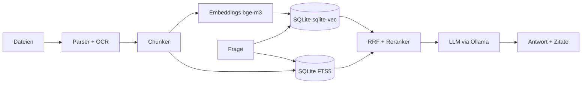

# LocalRAG – Semantische Suche über die eigenen Dateien

> Frag deinen Computer in natürlicher Sprache – komplett lokal, mit Quellenangabe.

**Status:** 🚧 Phase 1a fertig: Stichwortsuche (BM25) über PDF, DOCX, Markdown und TXT. Als Nächstes kommt die semantische Suche, siehe [PLAN.md](PLAN.md).

## Quickstart

Voraussetzung: [uv](https://docs.astral.sh/uv/).

```bash
git clone https://github.com/Dualshok3/RAG.git && cd RAG
uv sync
uv run localrag index "D:\Dokumente"          # inkrementell, beim zweiten Lauf nur Änderungen
uv run localrag search "Kündigungsfrist Mietvertrag"
uv run localrag status --errors
```

Der Index liegt standardmäßig unter `~/.localrag/localrag.db`. Mit der Umgebungsvariable `LOCALRAG_DB`
oder `--db` lässt er sich verlegen, z. B. auf eine andere Platte.

## Erste Messung: Was kann reines BM25?

Synthetischer Testkorpus mit 10 Dokumenten und 21 Fragen ([eval/](eval/)):

| Fragen | n | Recall@5 | MRR |
|---|---|---|---|
| Stichworte aus dem Dokument | 11 | 1.00 | 1.00 |
| Umschreibungen („Darf ich eine Katze halten?“ → *Haustiere*) | 10 | 0.00 | 0.00 |

Die Umschreibungen vermeiden bewusst die Wörter aus dem Dokument. Genau diese Lücke soll die
semantische Suche (Phase 1b) schließen. Selbst messen: `uv run python eval/run_eval.py`

## Idee

Die Windows-Suche findet Dateinamen und exakte Wörter. LocalRAG versteht den **Inhalt**:

```text
> localrag ask "Wie lange ist die Kündigungsfrist in meinem Mietvertrag?"

Die Kündigungsfrist beträgt drei Monate zum Monatsende [1].

[1] D:\Dokumente\Wohnung\Mietvertrag_2021.pdf – Seite 4, §5 Kündigung
```

## Geplante Features

- 🔒 **100 % lokal** – keine Daten verlassen den Rechner (Ollama + lokale Embeddings)
- 🔎 **Hybrid-Suche** – semantische Vektorsuche + BM25-Stichwortsuche + Reranking
- 📄 PDF, Word, Excel, PowerPoint, Markdown, E-Mails, Quellcode, OCR für Scans
- ⚡ **Inkrementelle Indexierung** – nur geänderte Dateien werden neu verarbeitet
- 📊 **Messbare Qualität** – Eval-Set mit Recall@k / MRR, Benchmark gegen die Windows-Suche
- 🤖 **MCP-Server** – Claude & Co. können direkt in den eigenen Dateien suchen

## Architektur



## Tech-Stack

Python 3.12 · uv · PyTorch/CUDA · sentence-transformers · SQLite (FTS5 + sqlite-vec) · Ollama · FastAPI · Typer · MCP

## Lizenz

Siehe [LICENSE](LICENSE).
