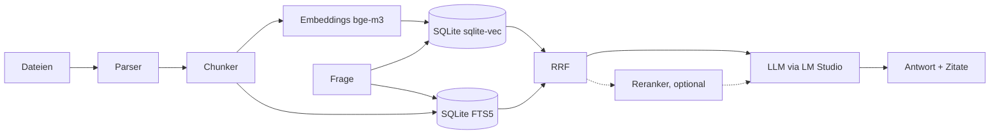

# LocalRAG – Semantische Suche über die eigenen Dateien

[](https://github.com/Dualshok3/RAG/actions/workflows/ci.yml)


> Frag deinen Computer in natürlicher Sprache – komplett lokal, mit Quellenangabe.

Die Windows-Suche findet Dateinamen und exakte Wörter. LocalRAG versteht den **Inhalt**: Die Frage
„Darf ich eine Katze halten?“ findet den Paragrafen *Haustiere* im Mietvertrag, obwohl das Wort „Katze“
dort nirgends steht.

```text
> localrag ask "Darf ich eine Katze halten?"

Die Haltung von Haustieren bedarf der vorherigen Zustimmung des Vermieters, ausgenommen es handelt
sich um Kleintiere in Käfigen [1].

Quellen
[1] D:\Dokumente\Wohnung\mietvertrag.md  · Mietvertrag Wohnung Lindenstraße 12 > §8 Haustiere
```

*Antwort von Gemma 4 26B über den synthetischen Testkorpus, Pfad gekürzt. Suche rund 30 ms, Antwort rund 3 s.*

## Was es kann

- 🔒 **100 % lokal:** Embeddings auf der eigenen GPU, Antworten über LM Studio oder einen anderen lokalen
  OpenAI-kompatiblen Server. Keine Cloud, kein Konto.
- 🔎 **Hybrid-Suche:** BM25-Stichwortsuche (SQLite FTS5, deutsches Stemming) plus Vektorsuche
  (bge-m3, sqlite-vec), zusammengeführt per Reciprocal Rank Fusion. Alles in **einer** SQLite-Datei,
  Begründung in [ADR 0001](docs/adr/0001-sqlite-statt-vektordatenbank.md).
- 💬 **Antworten mit Zitaten:** Jede Aussage ist mit `[n]` belegt. Steht nichts in den Dateien, sagt das
  Modell das, statt zu raten.
- ⚡ **Inkrementell:** Beim zweiten Lauf werden nur geänderte Dateien neu verarbeitet.
- 🎯 **Optionaler Reranker:** `--rerank` sortiert die Kandidaten mit einem Cross-Encoder neu, hilft bei
  umschriebenen Fragen, kostet aber rund 0,3 s pro Suche ([Messung](#härtere-fragen-und-reranker)).
- 🚀 **Hintergrunddienst:** `localrag serve` hält das Modell geladen, Suchen dauern dann Millisekunden.
- 🤖 **MCP-Server:** Claude Desktop, Claude Code und andere Clients können direkt in den Dateien suchen.
- 📊 **Gemessen statt behauptet:** Ein Eval-Set vergleicht Stichwort-, Vektor- und Hybridsuche, die
  Ergebnisse stehen [weiter unten](#messung-stichwort-vs-vektor-vs-hybrid).

Formate: PDF (gescannte PDFs per OCR, unter Windows ohne Zusatzsoftware), DOCX, Markdown, TXT. Weitere
Formate sind geplant, siehe [PLAN.md](PLAN.md).

## Quickstart

Voraussetzung: [uv](https://docs.astral.sh/uv/).

```bash
git clone https://github.com/Dualshok3/RAG.git && cd RAG
uv sync --extra semantic --extra ocr          # PyTorch/CUDA + Windows-OCR; ohne Extras: nur Stichwortsuche
uv run localrag index "D:\Dokumente"          # inkrementell, beim zweiten Lauf nur Änderungen
uv run localrag search "Darf ich eine Katze halten?"
uv run localrag search "PF-1234" --mode keyword   # schnell, ohne Modell
uv run localrag status --errors
```

| Variable | Bedeutung | Standard |
|---|---|---|
| `LOCALRAG_DB` | Index-Datenbank (auch `--db`) | `~/.localrag/localrag.db` |
| `LOCALRAG_MODELS` | Speicherort der Modelle (~4,5 GB) | Hugging-Face-Cache |
| `LOCALRAG_EMBEDDING_MODEL` | Embedding-Modell | `BAAI/bge-m3` |
| `LOCALRAG_LLM_URL` | OpenAI-kompatibler Chat-Server | `http://localhost:1234/v1` (LM Studio) |
| `LOCALRAG_LLM_MODEL` | Modell-ID auf dem Server | bereits geladenes Modell |

### Fragen beantworten (lokales LLM)

`localrag ask` sucht die passenden Textstellen und lässt ein lokales Sprachmodell daraus eine Antwort mit
Quellenangaben formulieren. Getestet mit [LM Studio](https://lmstudio.ai). Jeder OpenAI-kompatible Server
funktioniert ebenso (llama.cpp, vLLM, Ollama).

```bash
lms server start                     # LM-Studio-Server
lms load gemma-4-26b-a4b-it          # oder ein anderes Modell
uv run localrag ask "Wie hoch ist der neue Stromabschlag?"
```

Stichprobe mit 4 Fragen auf einer RTX 5060 Ti (16 GB): Beide Modelle antworten in rund 3 s.

| Modell | richtig | Auffälligkeit |
|---|---|---|
| Qwen3.5-9B | 3/4 | „Darf ich eine Katze halten?“ → „Ja“, weil es die Katze als „Kleintier in Käfigen“ einordnet |
| **Gemma 4 26B-A4B** (MoE) | **4/4** | nennt korrekt die Bedingung: Zustimmung des Vermieters |

Die Suche lieferte in beiden Fällen die richtige Klausel. Der Fehler liegt also beim Schlussfolgern des
kleineren Modells, nicht beim Retrieval.

Das Modell bekommt nur die gefundenen Textstellen und soll jede Aussage mit `[n]` belegen. Steht die
Antwort nicht in den Quellen, sagt es „Dazu habe ich in deinen Dateien nichts gefunden.“

Beim ersten Start wird bge-m3 heruntergeladen. Ohne Dienst lädt die CLI das Modell bei jeder Suche neu,
das dauert rund 20 s. Schneller geht es mit dem Hintergrunddienst:

```bash
uv run localrag serve            # hält das Modell geladen, nur unter 127.0.0.1 erreichbar
uv run localrag search "…"       # nutzt den Dienst automatisch → Antwort in Millisekunden
uv run localrag search "…" --local   # Dienst ignorieren
```

Der Dienst bietet auch eine HTTP-API (`/search`, `/ask`, `/health`, Doku unter `http://127.0.0.1:8765/docs`).
Weil er Inhalte deiner Dateien herausgibt, bindet er standardmäßig nur an 127.0.0.1.

### Als Werkzeug für Claude (MCP)

Mit `localrag mcp` bekommen Claude Desktop, Claude Code und andere MCP-Clients drei Werkzeuge:
`search_files`, `read_passage` (Volltext eines Treffers samt Nachbarabschnitten) und `index_status`.
Der Assistent kann damit mehrfach suchen und gezielt nachlesen.

```bash
uv sync --extra semantic --extra mcp
claude mcp add localrag -- uv --directory C:\pfad\zu\RAG run localrag mcp --allow "D:\Dokumente"
```

Für Claude Desktop in `claude_desktop_config.json`:

```json
{
  "mcpServers": {
    "localrag": {
      "command": "uv",
      "args": ["--directory", "C:\\pfad\\zu\\RAG", "run", "localrag", "mcp", "--allow", "D:\\Dokumente"],
      "env": { "LOCALRAG_DB": "D:\\localrag\\localrag.db", "LOCALRAG_MODELS": "D:\\localrag\\models" }
    }
  }
}
```

> **Datenschutz:** Was die Werkzeuge zurückgeben, landet im Kontext des Assistenten. Bei einem
> Cloud-Modell verlassen diese Ausschnitte deinen Rechner, anders als bei `localrag ask` mit LM Studio.
> Mit `--allow` lässt sich die Herausgabe auf bestimmte Ordner begrenzen. Treffer aus anderen Ordnern
> verschweigt der Server dann komplett.

## Messung: Stichwort vs. Vektor vs. Hybrid

Synthetischer Testkorpus mit 16 Dokumenten und 35 Fragen ([eval/results/latest.md](eval/results/latest.md)).
Er enthält absichtlich ähnliche Dokumente als Fallen: Stromrechnung 2023 und 2024, Wohnungs- und
Garagenmietvertrag, alter und aktueller Arbeitsvertrag.

| Fragen | n | BM25 | Vektor (bge-m3) | Hybrid (RRF) |
|---|---|---|---|---|
| Stichworte aus dem Dokument | 12 | 1.00 | 1.00 | 1.00 |
| Umschreibungen („Darf ich eine Katze halten?“ → *Haustiere*) | 13 | 0.23 | **0.92** | 0.69 |
| Exakte Kennungen (Seriennummer, IP, Betrag) | 5 | **1.00** | 0.40 | **1.00** |
| Ähnliche Dokumente unterscheiden („Strom **2023**“) | 5 | 0.20 | **1.00** | 0.60 |
| **Gesamt** | 35 | 0.60 | **0.89** | 0.83 |

Angegeben ist Recall@1, also wie oft die richtige Datei auf Platz 1 steht. Bei Recall@3 erreichen
Vektor und Hybrid jeweils 1.00, die richtige Datei ist also immer unter den ersten drei. Latenz pro Suche
auf der GPU: rund 22 ms.

Was man daraus lernt:
- **BM25** scheitert an Umschreibungen, **Vektoren** an exakten Kennungen.
- **Hybrid** ist bei Kennungen perfekt, verliert aber bei Umschreibungen Plätze. Einfaches RRF gewichtet
  beide Listen gleich. Findet BM25 nur zufällige Wortübereinstimmungen in falschen Dateien, schieben
  diese den richtigen Vektor-Treffer auf Platz 2 oder 3.
- Hybrid bleibt der Standard, weil es nie komplett danebenliegt. Für Platz 1 gibt es inzwischen den
  optionalen Reranker, siehe [Härtere Fragen und Reranker](#härtere-fragen-und-reranker).

Einschränkung: 35 Fragen sind wenig, ein bis zwei Fragen verschieben die Werte um mehrere Prozentpunkte.
Selbst messen: `uv run python eval/run_eval.py`

## Test mit echten Dateien

Auch an einem echten Rechner getestet: Desktop, Dokumente, Downloads und ein Studienordner mit 334 Dateien.
Darunter sind Verträge, Studienunterlagen, eine Abschlussarbeit, fünf Fachbücher mit mehreren hundert
Seiten und typischer Ballast wie Spiele-Konfigurationen. Die Fragen und Daten bleiben privat, hier stehen
nur die Zahlen. Hardware: RTX 5060 Ti 16 GB.

| Schritt | Zeit |
|---|---|
| Text extrahieren + Stichwortindex (334 Dateien → 6.788 Abschnitte) | 33 s |
| Vektoren berechnen (bge-m3, GPU) | 102 s (~67 Abschnitte/s) |
| Zweiter Lauf, nichts geändert | 0,2 s |
| Indexgröße | 66 MB |

| Suche | p50 | p95 |
|---|---|---|
| Stichwort (im Prozess) | 4,6 ms | 10 ms |
| Hybrid (im Prozess, inkl. Frage einbetten) | 51 ms | 64 ms |
| Hybrid über den Dienst (HTTP) | 117 ms | 139 ms |
| `localrag search` über den Dienst (inkl. Python-Start) | ~2 s | |
| `localrag search` ohne Dienst (Modell wird geladen) | ~19 s | |
| `localrag ask` mit Gemma 4 26B über den Dienst | 6–8 s | |

**Trefferquote** bei 24 Fragen mit bekannter richtiger Datei, darunter zwei zu gescannten PDFs:

| | BM25 | Vektor | Hybrid | Windows-Suche |
|---|---|---|---|---|
| Recall@1 | 0.79 | 0.75 | **0.79** | 0.25 |
| Recall@5 | 0.83 | 0.92 | **0.96** | 0.25 |

Die Windows-Suche indexiert standardmäßig nur die Benutzerordner auf C:, der Studienordner auf D: fehlt
ihr komplett. Nur auf die Fragen zu Dateien gerechnet, die sie kennt, findet sie 6 von 13. Ganze Sätze
liefern dort fast immer null Treffer, nur Stichworte und Kennungen funktionieren.

Der erste Durchlauf hat Schwächen aufgedeckt, die inzwischen behoben sind:

| Befund | Lösung | Wirkung |
|---|---|---|
| 8 gescannte PDFs ohne Textebene, z. B. ein Zeugnis | OCR über die eingebaute Windows-Texterkennung, gedrehte Scans werden automatisch erkannt | alle 8 lesbar, „Welche Note steht in meinem Zeugnis?“ wird richtig beantwortet |
| Viele fast gleiche Backups derselben Datei belegen alle Top-Plätze | Nahezu gleiche Abschnitte (≥ 85 % gleiche Wörter) zu einem Treffer zusammenfassen, Hinweis „+ gleicher Inhalt in …“ | Platz frei für andere Dateien |
| DOCX mit beschädigtem eingebettetem Bild nicht lesbar | Text notfalls direkt aus `word/document.xml` lesen | Datei lesbar |
| Leere Antwort des LLM bei unbeantwortbarer Frage | Fester Satz „Dazu habe ich in deinen Dateien nichts gefunden.“ | |
| Kein Modell geladen → LM Studio lud ungefragt ein anderes (10 GB) | Klare Fehlermeldung statt stillem Wechsel | |

Recall@5 von Hybrid stieg dadurch von 0.88 auf 0.96, gerechnet über dieselben 24 Fragen.

### Härtere Fragen und Reranker

Die 24 Fragen oben entstanden nach dem Lesen der Dokumente und teilen deshalb oft Wörter mit ihnen, das
begünstigt BM25. Deshalb gibt es ein zweites Set mit 12 Fragen, die bewusst andere Wörter benutzen
(Frage und Dokument haben kein Wort gemeinsam), zwei davon
auf Deutsch zu englischen Dokumenten. Dazu der Reranker
[bge-reranker-v2-m3](https://huggingface.co/BAAI/bge-reranker-v2-m3), der die 40 besten Abschnitte der
ersten Stufe zusammen mit der Frage liest:

| | Recall@1 | Recall@5 | MRR | p50 |
|---|---|---|---|---|
| **24 Fragen** · Hybrid | 0.79 | **0.96** | 0.85 | 53 ms |
| **24 Fragen** · Hybrid + Reranker | **0.88** | **0.96** | **0.92** | 386 ms |
| **12 schwere** · BM25 | 0.17 | 0.33 | 0.22 | 10 ms |
| **12 schwere** · Vektor | **0.42** | **0.67** | **0.50** | 49 ms |
| **12 schwere** · Hybrid | 0.25 | 0.42 | 0.37 | 55 ms |
| **12 schwere** · Hybrid + Reranker | 0.17 | **0.67** | 0.35 | 391 ms |

Was man daraus lernt:
- Ohne gemeinsame Wörter zieht BM25 die Hybridsuche nach unten: Vektor allein ist hier klar besser.
- Der Reranker holt das bei Recall@5 wieder auf und verbessert bei den leichteren Fragen Platz 1, kostet
  aber gut 0,3 s pro Suche. Bei den schweren Fragen landet die richtige Datei mit ihm öfter unter den
  ersten fünf, aber seltener ganz oben.
- Drei Fragen findet keine Variante: kurze E-Mails, deren Inhalt fast nur aus Platzhaltern besteht, und
  eine Rechnung, die fast nur aus Großbuchstaben-Kürzeln besteht.
- Deshalb ist der Reranker **optional** (`--rerank` bei `search`, `ask` und `serve`), nicht Standard. Bei
  12 Fragen verschiebt eine einzige Frage die Werte um 8 Prozentpunkte. Für eine Standardänderung braucht
  es mehr Fragen.

## Architektur



| Schritt | Umsetzung | Code |
|---|---|---|
| Parsen | PyMuPDF (PDF, pro Seite), python-docx (Überschriften, Tabellen), Markdown/TXT | [ingest/parsers](src/localrag/ingest/parsers) |
| Chunking | Absätze zu ~350 Wörtern packen, 50 Wörter Überlappung, Überschriftenpfad merken | [chunker.py](src/localrag/ingest/chunker.py) |
| Stichwortindex | FTS5 mit BM25, Text vorab per Snowball auf Wortstämme reduziert | [text_norm.py](src/localrag/index/text_norm.py) |
| Vektorindex | bge-m3 (1024 Dim., fp16 auf CUDA), normalisiert in sqlite-vec | [vector_store.py](src/localrag/index/vector_store.py) |
| Fusion | Reciprocal Rank Fusion (k = 60) über beide Trefferlisten | [hybrid.py](src/localrag/retrieval/hybrid.py) |
| Reranking (optional) | bge-reranker-v2-m3 liest Frage + Abschnitt gemeinsam, sortiert die Top 40 neu | [reranker.py](src/localrag/retrieval/reranker.py) |
| Antwort | Prompt nur mit Quellen, Zitatpflicht, Schutz vor Anweisungen in Dokumenten | [prompts.py](src/localrag/generation/prompts.py) |

## Geplant

Excel, PowerPoint, E-Mails · OCR für Bilddateien und andere
Betriebssysteme · Dateiüberwachung · Web-Oberfläche. Reihenfolge und Begründung stehen in [PLAN.md](PLAN.md).

## Keine privaten Daten im Repo

Das Projekt arbeitet mit sehr persönlichen Dateien, deshalb gibt es mehrere Sicherungen:

- Index, Modelle und Dokumente liegen außerhalb des Repos (`~/.localrag`, `LOCALRAG_MODELS`).
- Der Testkorpus ist vollständig erfunden ([eval/corpus](eval/corpus)). Test-PDFs und -DOCX entstehen erst
  zur Laufzeit.
- [pre-commit](.pre-commit-config.yaml) blockiert Dokumente, Datenbanken und `.env`-Dateien
  ([check_private_files.py](scripts/check_private_files.py)) und sucht mit gitleaks nach Geheimnissen.
  gitleaks läuft zusätzlich in der CI.

## Tech-Stack

Python 3.12 · uv · PyTorch/CUDA · sentence-transformers · SQLite (FTS5 + sqlite-vec) · LM Studio (OpenAI-API) · httpx · FastAPI · Typer · MCP

## Entwickeln

```bash
uv sync                          # ohne PyTorch, Tests nutzen ein Fake-Embedding
uv run pytest -q
uv run ruff check . && uv run ruff format --check .
uvx pre-commit install           # Schutz vor privaten Dateien und Secrets bei jedem Commit
```

Die CI läuft unter Windows und Ubuntu und prüft zusätzlich, dass die Stichwortsuche im Eval eine
Mindestqualität hält.

## Lizenz

Siehe [LICENSE](LICENSE).
