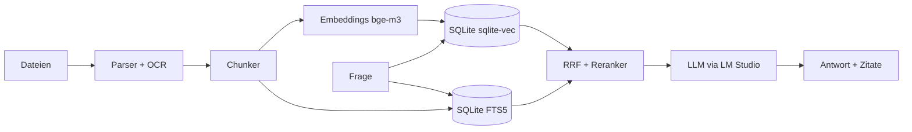

# LocalRAG – Semantische Suche über die eigenen Dateien

> Frag deinen Computer in natürlicher Sprache – komplett lokal, mit Quellenangabe.

**Status:** 🚧 Hybrid-Suche aus BM25 und Vektoren (bge-m3) über PDF, DOCX, Markdown und TXT. Antworten mit Quellenangabe per lokalem LLM (LM Studio) funktionieren, die Antwortqualität ist aber noch nicht gemessen. Details in [PLAN.md](PLAN.md).

## Quickstart

Voraussetzung: [uv](https://docs.astral.sh/uv/).

```bash
git clone https://github.com/Dualshok3/RAG.git && cd RAG
uv sync --extra semantic                      # inkl. PyTorch/CUDA; ohne Extra: nur Stichwortsuche
uv run localrag index "D:\Dokumente"          # inkrementell, beim zweiten Lauf nur Änderungen
uv run localrag search "Darf ich eine Katze halten?"
uv run localrag search "PF-1234" --mode keyword   # schnell, ohne Modell
uv run localrag status --errors
```

| Variable | Bedeutung | Standard |
|---|---|---|
| `LOCALRAG_DB` | Index-Datenbank (auch `--db`) | `~/.localrag/localrag.db` |
| `LOCALRAG_MODELS` | Speicherort der Modelle (~4,5 GB) | Hugging-Face-Cache |
| `LOCALRAG_EMBEDDING_MODEL` | Embedding-Modell | `BAAI/bge-m3` |
| `LOCALRAG_LLM_URL` | OpenAI-kompatibler Chat-Server | `http://localhost:1234/v1` (LM Studio) |
| `LOCALRAG_LLM_MODEL` | Modell-ID auf dem Server | bereits geladenes Modell |

### Fragen beantworten (lokales LLM)

`localrag ask` sucht die passenden Textstellen und lässt ein lokales Sprachmodell daraus eine Antwort mit
Quellenangaben formulieren. Getestet mit [LM Studio](https://lmstudio.ai). Jeder OpenAI-kompatible Server
funktioniert ebenso (llama.cpp, vLLM, Ollama).

```bash
lms server start                     # LM-Studio-Server
lms load qwen3.5-9b                  # oder ein anderes Modell
uv run localrag ask "Wie hoch ist der neue Stromabschlag?"
```

Das Modell bekommt nur die gefundenen Textstellen und soll jede Aussage mit `[n]` belegen. Steht die
Antwort nicht in den Quellen, sagt es „Dazu habe ich in deinen Dateien nichts gefunden.“

Beim ersten Start wird bge-m3 heruntergeladen. Ohne Dienst lädt die CLI das Modell bei jeder Suche neu,
das dauert rund 20 s. Schneller geht es mit dem Hintergrunddienst:

```bash
uv run localrag serve            # hält das Modell geladen, nur unter 127.0.0.1 erreichbar
uv run localrag search "…"       # nutzt den Dienst automatisch → Antwort in Millisekunden
uv run localrag search "…" --local   # Dienst ignorieren
```

Der Dienst bietet auch eine HTTP-API (`/search`, `/ask`, `/health`, Doku unter `http://127.0.0.1:8765/docs`).
Weil er Inhalte deiner Dateien herausgibt, bindet er standardmäßig nur an 127.0.0.1.

## Messung: Stichwort vs. Vektor vs. Hybrid

Synthetischer Testkorpus mit 10 Dokumenten und 25 Fragen ([eval/results/latest.md](eval/results/latest.md)):

| Fragen | n | BM25 | Vektor (bge-m3) | **Hybrid (RRF)** |
|---|---|---|---|---|
| Stichworte aus dem Dokument | 11 | 1.00 | 1.00 | **1.00** |
| Umschreibungen („Darf ich eine Katze halten?“ → *Haustiere*) | 10 | 0.00 | 1.00 | **0.90** |
| Exakte Kennungen (Seriennummer, IP, Betrag) | 4 | 1.00 | 0.50 | **1.00** |
| **Gesamt** | 25 | 0.60 | 0.92 | **0.96** |

Angegeben ist Recall@1, also wie oft die richtige Datei auf Platz 1 steht. Bei Recall@5 erreichen
Vektor und Hybrid jeweils 1.00. Das Bild ist klar: BM25 scheitert an Umschreibungen, Vektoren an exakten
Kennungen, und Hybrid gleicht beides aus.

Einschränkung: Mit 10 Dokumenten ist der Korpus klein und leicht. Ein größeres, schwierigeres Eval-Set
ist für Phase 3 geplant. Selbst messen: `uv run python eval/run_eval.py`

## Idee

Die Windows-Suche findet Dateinamen und exakte Wörter. LocalRAG versteht den **Inhalt**:

```text
> localrag ask "Wie lange ist die Kündigungsfrist in meinem Mietvertrag?"

Die Kündigungsfrist beträgt drei Monate zum Monatsende [1].

[1] D:\Dokumente\Wohnung\Mietvertrag_2021.pdf – Seite 4, §5 Kündigung
```

## Geplante Features

- 🔒 **100 % lokal** – keine Daten verlassen den Rechner (LM Studio oder jeder andere OpenAI-kompatible Server + lokale Embeddings)
- 🔎 **Hybrid-Suche** – semantische Vektorsuche + BM25-Stichwortsuche + Reranking
- 📄 PDF, Word, Excel, PowerPoint, Markdown, E-Mails, Quellcode, OCR für Scans
- ⚡ **Inkrementelle Indexierung** – nur geänderte Dateien werden neu verarbeitet
- 📊 **Messbare Qualität** – Eval-Set mit Recall@k / MRR, Benchmark gegen die Windows-Suche
- 🤖 **MCP-Server** – Claude & Co. können direkt in den eigenen Dateien suchen

## Architektur



## Tech-Stack

Python 3.12 · uv · PyTorch/CUDA · sentence-transformers · SQLite (FTS5 + sqlite-vec) · LM Studio (OpenAI-API) · httpx · FastAPI · Typer · MCP

## Lizenz

Siehe [LICENSE](LICENSE).
